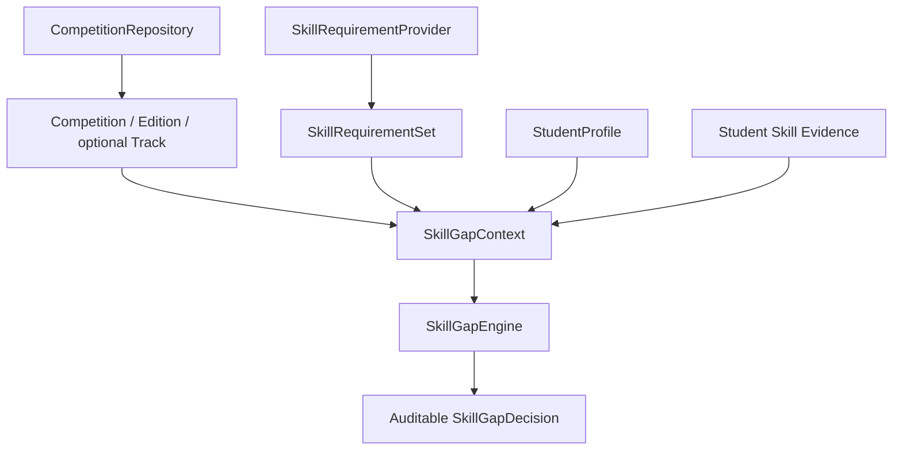
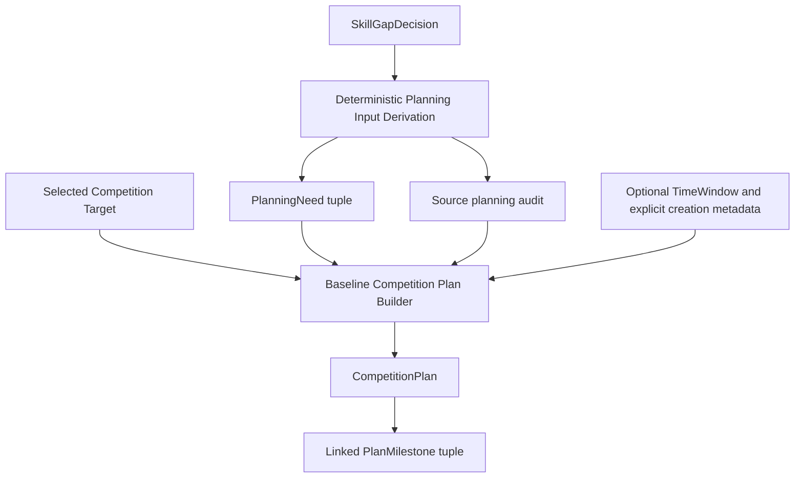

# Competition Copilot Architecture

## P11 Adaptive Replanning - Phase Closure

Status: CLOSED. Final Review: PASS. Frozen: YES / FROZEN FOR DOWNSTREAM USE.
P12 Agent: CLOSED_FROZEN; Final Review: REVIEW_PASS. P13 is IN_PROGRESS (P13.3 safe execution); production deployment remains deferred to P16.
Canonical phase-status source: `docs/DEVELOPMENT_PLAN.md`; this document must agree.

| Phase | Scope | Status |
|---|---|---|
| P11 | Adaptive Replanning | CLOSED / FINAL REVIEW PASS / FROZEN FOR DOWNSTREAM USE |
| P11.1 | Adaptive Replanning Contract | CLOSED / FROZEN |
| P11.1.2 | Canonical Plan Reference Serialization Compatibility Fix | CLOSED / FROZEN |
| P11.2 | Deterministic Event Impact Analysis | CLOSED / FROZEN |
| P11.3 | Replanning Decision + Affected Scope | CLOSED / FROZEN |
| P11.3.5 | Structured Replanning Input | CLOSED / FROZEN |
| P11.4 | Deterministic Plan Revision + PlanDiff | CLOSED / FROZEN |
| P11.4.2 | Plan-Level Replanning Resolution | CLOSED / FROZEN |
| P11.5 | Real Adaptive Replanning Integration | CLOSED / FROZEN |
| P12 | Agent | CLOSED_FROZEN |
| P13 | MCP + AgentArts MCP compatibility | IN_PROGRESS; P13.0-P13.2 REVIEW_PASS; P13.3 REVIEW_PASS |

### Frozen authority map

- P11.1: typed result Contract authority, including controlled mixed-scope/status Diff extensions.
- P11.1.2: canonical PlanReference compatibility, not a new business authority.
- P11.2: Event impact authority.
- P11.3: ReplanningDecision + AffectedPlanScope authority.
- P11.3.5: structured authorized WHAT-to-change authority, including explicit coverage resolution.
- P11.4 / P11.4.2: deterministic authorized revision execution authority.
- P11.5: real-component integration proof only; no new business authority.

### Frozen safety semantics

1. Impact is tri-state: NO_PLAN_IMPACT / UNDETERMINED / AFFECTS_PLAN.
2. Missing represented Plan dependency -> UNDETERMINED, never proven no-impact.
3. Decision precedence: any AFFECTS_PLAN -> REPLAN; else any UNDETERMINED ->
   UNDETERMINED; else -> KEEP_CURRENT_PLAN. No voting or severity score.
4. AffectedPlanScope describes WHERE; it is not a RevisionInstruction/operation.
5. Reason code is neither structured evidence nor approval authority.
6. Structural changes require typed explicit revision authority/evidence and exact
   Plan/version/before-state preconditions; no Event-to-Plan mutation guessing.
7. PARTIAL cannot masquerade as COMPLETE; partial structural execution rejects.
   COMPLETE requires explicit coverage authority AND semantic compatibility.
8. KEEP -> unchanged Plan, identity/version/metadata, and empty PlanDiff.
9. UNDETERMINED -> unresolved input and no speculative revision; distinct from KEEP.
10. Confirmed TARGET_TRACK_REMOVED + REPLAN + original whole-plan scope may be
    resolved operationally by explicitly approved draft/active -> cancelled.
11. Cancellation does not choose another track or erase the Event. Preserve target
    identity, needs, audit, horizon and historical milestones; no automatic deletion.
12. Revision is atomic, before Plan immutable, and PlanDiff derives from actual
    validated before/after. Status-only cancellation declares no milestone change.
13. Full Event -> Impact -> Decision -> original Scope -> authorized Resolution ->
    Input -> Authority -> before/after Plan -> PlanDiff lineage is required.
14. Legitimate sourced P8 Plans retain source_item/typed URLs and support deterministic
    PlanReference, stable audit JSON and legacy identity. Explicit AnyUrl serialization
    retains original UTC/key/sequence/enum rules; unknown types still reject.
15. P11 Domain services have no Repository access, persistence or network side effects.
16. No LLM/Agent owns P11 business authority; downstream orchestration must delegate
    impact, decisions, authority validation and execution to deterministic services.

### Integration proof and resolved evolution history

P11.5 validates all three offline production-component paths:
- Proven no-impact -> KEEP -> NO_REVISION_REQUIRED -> unchanged Plan + empty Diff.
- Missing dependency -> UNDETERMINED -> UNRESOLVED -> no speculative revision.
- Controlled TRACK_MEMBERSHIP_CHANGED / target removal -> AFFECTS_PLAN -> REPLAN ->
  explicit COMPLETE coverage -> HUMAN_APPROVED active -> cancelled -> actual status Diff.

Repository-backed target data is real local Seed; controlled changes/approval are
TEST-ONLY scenarios, not official historical events or a claim that Huawei removed
a track. Final Review PASS; exit criteria 16/16 PASS; validation: 1824 tests, 0 skipped,
Ruff PASS, Diff Check PASS. P11.5 commit: 5394316; sourced-reference fix: bf792fc.
Earlier reason/evidence, mixed-scope, revision-input and whole-plan capability
blockers are resolved by controlled evolution. The sourced HttpUrl Final Review
defect is resolved by P11.1.2. Detailed historical rationale below is retained;
none of these historical blockers is an open P11 issue.

### Deferred scope and P12 boundary

P11 does not implement automatic replacement-track selection, automatic Eligibility/
Recommendation/SkillGap reruns, new PlanningNeed derivation from Events, Plan save/
replacement, Event history persistence, cross-run dedup persistence, scheduler/polling,
notification, Agent, MCP or frontend. Severity/impact scoring remains deferred.
Target-added impact has no complete cancellation policy. No supersession/replacement
relation or arbitrary Plan status machine is implied by the existing status enum.

P12 is CLOSED_FROZEN. Injected model proposals and explicit human replies are validated; the isolated Runtime Adapter reuses the same core graph. The Agent may understand natural-language intent,
select tools/workflows, orchestrate, clarify, explain and collect explicit approval.
It must not own Eligibility, Recommendation scoring, SkillGap, Event impact,
ReplanningDecision or revision execution rules; must not turn PARTIAL into COMPLETE,
bypass Revision Authority or mutate Plans directly. Approval collection submits
structured inputs through an authorized boundary; Domain remains the business authority.


> P0 架构设计；本文定义边界和数据契约，不代表相关模块已经实现。

## 1. Architecture Goals

系统须模块化、可测试、可解释，且独立于具体 Agent 平台。赛事事实可追溯到来源与核验状态；资格、推荐和重规划可回放其输入、规则版本与证据。未来接入 Huawei AgentArts 时只调整运行、编排和适配边界，不改写 Domain、Decision、Planning 的业务能力。

## 2. Overall Layered Architecture

运行时能力调用的完整参考路径为：

```text
Frontend
  ↓
API
  ↓
Application / Workflow
  ↓
Tool
  ↓
Domain Service
  ↓
Repository Interface
  ↓
Infrastructure Adapter
```

此图展示允许的由外到内路径，不要求每次请求经过全部节点。普通 API 请求由 Application 编排 Domain Service；Agent Runtime 和 MCP 从上层调用 Tool，不能直接操作数据库。需要由 Workflow 发起 Tool 调用时，Workflow 依赖抽象 Tool Port；Tool 可调用独立的 Application 用例或 Domain Service，但不得回调同一个发起用例。运行时最后一步由接口委托 Adapter；源码依赖相反，由 Adapter 实现接口，内层代码不导入具体 Adapter。

## 3. Domain Layer

`Competition` 表示跨届赛事身份；`CompetitionEdition` 表示某一届的规则与时间范围；`CompetitionTrack` 表示该届赛道及其条件。`StudentProfile` 记录学生授权提供的背景、目标和时间约束；`Skill` 是版本化能力词表；`LearningResource` 是可溯源的学习材料。`CompetitionEvent` 表示已核验的赛事状态变化；`CompetitionPlan` 表示有任务、依赖、期限和版本的个人备赛计划。辅助概念包括 `SkillGap`、`DecisionResult`、`Snapshot` 和 `Diff`。Domain Service 承担资格、匹配、诊断、规划约束与影响规则，不依赖 LLM、Agent SDK 或数据库实现。

## 4. Data Architecture

**Static Competition Knowledge** 保存赛事、届次、赛道、资格规则、技能要求和官方材料等相对稳定的知识。当前 frozen **Dynamic Competition State** 仅建模 registration window、competition window、track membership 及其 observation coverage；材料清单变化和规则修订尚未纳入 structured SnapshotDiff / P10 mapping。静态知识与动态状态分开建模，避免一条赛事记录同时承担身份、规则和实时状态。

P9 Competition Digital Twin 用版本化 `Snapshot` 表达某届赛事在某次观测后的状态，比较快照生成低层 `SnapshotDiff`。P9.5 负责来源观察与 one-shot Monitor；已实现的 P10 把 Diff 转成 primitive / canonical `CompetitionEvent`。动态状态不得静默覆盖。每条用于判断的关键事实都保存 `source_url`、`source_type`、`observed_at`、`verification_status`；未经验证的事实只能作为待核验线索。

## 5. Data Ingestion Architecture

```text
External Source → Raw → Normalize → Validate → Candidate
→ Human Approval → Source Verification → Verified Seed
```

P2 已完成上述可审计的文件数据链：Raw 保留原始证据，Normalizer 只做确定性结构化，Validator 不代替人工判断。Human Review Manifest 以 Raw SHA256 绑定明确的批准和来源核验决定；执行器默认 dry-run，只有显式执行才生成 Verified Seed。未批准或未核验的 Candidate 不得成为正式业务数据，也不得支持确定性资格、推荐或计划决策。当前共有 12 份 Verified Seed，兼容 1.0 与 1.1；P2 ingestion scope is frozen。

P3 Repository 以 Verified Seed 为正式数据输入，通过 `Competition`、`CompetitionEdition`、`CompetitionTrack`、`SourceMetadata` 和 `TimeWindow` 读取核心事实；不直接以 `data/raw` 为业务数据源，也不要求常规读取方解析 Manifest 或 `raw_payload`。Manifest 保留在 ingestion audit layer。阶段日程、资格、团队规则、名额、评审、奖项和动态状态的结构化属于后续阶段。

## 6. Competition Monitoring Architecture

```text
P9: Repository-backed Snapshot / deterministic SnapshotDiff
P9.5: Approved Official Source -> Official Source Observation Adapter
       -> SourceObservationResult -> One-shot Monitor -> CompetitionSnapshot
       -> P9 Snapshot Diff Engine -> SnapshotDiff -> MonitorCheckResult
Implemented P10: SnapshotDiff -> primitive CompetitionEvent[] -> canonical CompetitionEvent[]
P11 (CLOSED / FROZEN): CompetitionEvent -> Impact / Adaptive Replanning
```

Monitor 一次调用取得 typed observation，保留配置的 verification status，使用 P9 构造 Snapshot 并计算低层 Diff，不自动验证官网或升级核验状态。Source failure 不产生 Snapshot/Diff；成功观察可含 UNKNOWN，无变化也是 SUCCESS + zero Diff。Repository/data 只读。SnapshotDiff 和 MonitorCheckResult 均不是 CompetitionEvent；P10 不重新抓网页、构造 Snapshot 或计算 Diff。Event 幂等/关联由 P10 负责，Impact/Replanning 由 P11 负责。

Scheduler/polling loop 尚未实现，属于 deferred runtime policy，不是 P9.5 退出要求。未来 scheduler 只调用 one-shot Monitor，不重新定义 Monitor semantics；当前无 Snapshot history persistence。

## 7. Decision Architecture

```text
Hard Constraints → Candidate Filtering → Matching Score → Ranking → DecisionResult
```

Domain Service 使用版本化输入和规则确定性检查硬资格；事实缺失或未核验时返回待核验状态，不能推断为合格。只有通过硬约束的已核验赛事进入匹配评分与排序。评分公式和版本属于 Domain，不属于 Agent 或 Repository。`DecisionResult` 返回状态、排序依据、稳定的 `reason_code` 与逐项 `evidence`，引用事实来源及规则版本。用户旅程中 Agent 在资格检查前给出的赛事仅为发现候选清单，不是最终合格结论或正式排名。

P5.1 的 `domain/eligibility.py` 定义独立的硬资格契约：`EligibilityContext` 显式携带学生和正式 Competition/Edition/可选 Track 快照；纯 `EligibilityRule` 对目标返回带稳定规则 ID、作用层级、reason code 和现有 `Evidence` 的 `RuleEvaluation`。`EligibilityDecision` 复用 `DecisionResult` 的 reason codes 与 evidence，并以 `ELIGIBLE`、`INELIGIBLE`、`UNKNOWN` 表示资格；缺少画像或规则资料属于一等的 `UNKNOWN`，未记录限制不等于已确认没有限制。P5.2 负责已准备规则的确定性聚合，P5.3 再接入真实结构化资格数据和适用规则准备。资格只判断官方硬约束；技能、兴趣和匹配度属于后续推荐或诊断。规则不得读取 Repository、Raw、Manifest、系统时间、网络或 LLM；若未来需要评估时间，须显式作为输入。

P5.2 的 `domain/eligibility_engine.py` 接收已准备好的 Context 与适用规则序列，按输入顺序逐条执行且不提前结束，保留全部逐条结论及原始证据顺序；最终状态按 `INELIGIBLE > UNKNOWN > ELIGIBLE` 聚合。空规则集返回 `UNKNOWN / RULE_DATA_MISSING`。重复规则 ID、规则返回 ID/scope/目标不一致或规则程序异常均为评估错误，不伪装为业务 `UNKNOWN`。调用方仍须保证规则集覆盖正式适用规则；真实规则发现和数据接入不属于 P5.2。

P5.3 引入独立于 P2 Seed 的 `data/eligibility/` 结构化 Policy：每项硬约束保留正式来源，Policy 明示 complete/partial 覆盖状态。Application 使用抽象 `CompetitionRepository` 和 `EligibilityPolicyProvider` 准备目标与规则，再委托 P5.2 Engine；JSON Policy Adapter 仅在 Infrastructure 层读取 P5 Artifact。缺 Policy 为 `UNKNOWN / RULE_DATA_MISSING`；partial Policy 会保留未结构化条件的 UNKNOWN，因此已满足某项学历限制不等于确认整届合格。Runtime 不解析 Raw 或 Manifest。当前首批仅覆盖两个已核验通知中的学历层级事实；在读、全日制、团队及例外资格仍需后续数据模型与结构化规则。

P5.4 已通过真实 Verified Seed → `JsonSeedCompetitionRepository` → `CompetitionRepository`，以及独立 P5 Policy → `JsonEligibilityPolicyProvider` → `EligibilityPolicyProvider` 的集成测试，验证 `CompetitionEligibilityEvaluator`、P5.2 Engine 和可序列化的 `EligibilityDecision` 全链路；P5 Final Review PASS。Decision 保留目标、最终状态、逐条规则 ID/状态、reason codes、画像事实证据、官方约束来源及系统覆盖缺口。系统 coverage assessment 不附官方来源。`PARTIAL` Policy 的已知规则满足加覆盖缺口为 `UNKNOWN`；明确违反加覆盖缺口仍为 `INELIGIBLE`。缺画像信息为 `UNKNOWN / PROFILE_DATA_MISSING`，缺结构化规则或 Policy 为 `UNKNOWN / RULE_DATA_MISSING`；只有全部适用硬规则明确满足且覆盖完整才可判 `ELIGIBLE`。

**P5 Eligibility scope is frozen.** P5 判断官方硬资格约束；技能、兴趣、经验、获奖概率、偏好、学习成本和排名属于 P6 及后续软匹配能力。P6 按 `Eligibility → Soft Suitability → Recommendation / Ranking` 消费 P5 结果，不得重做资格判断：`INELIGIBLE` 不因高分变为可参加，`UNKNOWN` 不伪装成确认合格。Recommendation、Skill Gap、Planning、Agent 和 MCP 不得重新实现 P5 三值状态、硬规则、聚合优先级、缺失数据或 Policy coverage 语义；仅真正的 Eligibility contract / semantic defect 可重新打开 P5。研究生入学状态、全日制/在读状态、Team Context、团队规则及更多 Policy 属未来数据和 Domain 需求，当前保持保守 `UNKNOWN`。

P6.1 在 `domain/recommendation.py` 建立单候选纯 Domain 契约：`RecommendationContext` 携带 StudentProfile、正式 Competition/Edition/可选 Track 快照、稳定 Candidate ID 和 P5 `EligibilityDecision`，构造时拒绝目标或资格结果错配。`RecommendationEvaluation` 复用 `DecisionResult` 的 reason codes 与 `Evidence`，保留原始资格结果；推荐状态与资格状态分离。`ELIGIBILITY_BLOCKED` 对应 P5 `INELIGIBLE`，不携带软分数；`ELIGIBILITY_UNCERTAIN` 对应 P5 `UNKNOWN`，允许将来记录软适配度但不能确认推荐；仅 P5 `ELIGIBLE` 可产生正常推荐或不推荐结果，亦可在软资料不足时保持适配度未确定。可选 0–1 分数只表示软适配度，并需分项证据，不是资格概率。P6.1 不执行评分、权重计算、跨候选排序或 Skill Gap 诊断；这些仍属后续阶段。Contract 不依赖 Repository、Tool、Infrastructure、文件系统、网络或 LLM。

P6.1 的 Context、Candidate、ScoreComponent 和 Evaluation 为不可变快照，P6 自有集合采用 tuple。共享 Domain 输入会转换为经过校验的独立冻结视图；资格视图继承 P5 原有字段、三值状态及校验，并保留完整审计，不重做资格语义。原始 P5 决策、赛事或画像对象的后续修改不会改变已经验证的 P6 快照；不同结果须重新构造合法快照，未验证的 copy update 被拒绝。

P6.2 adds the pure Domain `RecommendationScoringEngine` in `domain/recommendation_scoring.py`. It accepts one prepared context and ordered `SuitabilityScorer` components with finite nonnegative weights (default 1.0). INELIGIBLE bypasses scorers; UNKNOWN remains eligibility uncertain even with a high soft score. Available positive-weight components use `sum(score * weight) / sum(active weight)`. None signals are unavailable, excluded rather than zero-scored; zero-weight results are still audited. No active signals yields undetermined suitability for ELIGIBLE. Evidence records configured weights, missing component IDs, component facts, scoring version `weighted-average-v1`, and threshold. The default threshold 0.5 is a deterministic MVP heuristic; equality recommends only eligible candidates. Duplicate IDs, invalid results and scorer exceptions fail as engine errors. Competition Domain has no structured skill requirements yet: tests inject synthetic scorers, with no guessed real skill mapping. No ranking, Top-K, repository orchestration, LLM or network is introduced. P6.1 and P5 contracts remain unchanged.

P6.3 adds `domain/recommendation_ranking.py`: a pure `RecommendationRankingEngine`
consuming already scored `RecommendationEvaluation` snapshots. The immutable
`RecommendationRankingResult` separates confirmed eligible rankings, eligibility
uncertain rankings, and blocked reporting. Confirmed and uncertain ranks each
start at 1 and are continuous within their bucket. Available scores sort descending;
unavailable scores follow all numeric scores, including zero. Exact ties use
ascending `(competition_id, edition_id, track_id or "")`; scores are never rounded.
Blocked candidates have target-ID order only, without a recommendation rank.
Duplicate targets fail before sorting; empty input returns three empty tuples.
The result validates bucket membership, rank continuity, ordering and uniqueness,
preserves full evaluations without rewriting them, and records stable policy
`eligibility_buckets_score_desc_target_id_v1`. There is no global mixed rank,
rescoring, eligibility re-evaluation, candidate discovery, Top-K truncation,
Repository access, LLM or network. P6.1/P6.2 and frozen earlier contracts stay unchanged.

P6.4 integration acceptance connects real `JsonSeedCompetitionRepository`,
`JsonEligibilityPolicyProvider` and `CompetitionEligibilityEvaluator` to the
production P6 scoring and ranking engines. Soft scores are test-only target-ID
fixtures; synthetic ELIGIBLE decisions test normal paths without changing real
partial policies. Tests preserve nested audit and JSON, verify target integrity,
determinism and read-only execution, and require no Raw/Manifest runtime reads.
No production orchestration or real skill mapping is added. P6.1, P6.2, P6.3,
P6.4 and P6 Final Review all passed; **P6 Recommendation — COMPLETE**.

**P6 Recommendation scope is frozen.** P5 hard eligibility answers whether the
student may participate; P6 soft recommendation evaluates suitability when
eligibility permits or remains uncertain. INELIGIBLE remains blocked, UNKNOWN
cannot become confirmed recommended even with a high score, and ELIGIBLE is not
automatically recommended. Suitability scores express neither eligibility
confidence nor winning / competition success probability. Uncertain bucket ranks
are conditional ordering, not confirmed recommendation ranks.

P6 Evaluation, RankingResult and RankedRecommendation are validated immutable
snapshots; different results require new validated snapshots. P6 Domain depends
on no Repository, Infrastructure, Tool, filesystem, Seed, Raw, Manifest, network
or LLM. Skill Gap, Planner, Agent, MCP and Frontend must not reimplement or
override P5 eligibility semantics or P6 RecommendationStatus, scoring,
missing-signal and ranking-bucket semantics. Only a genuine P6 contract / semantic
defect reopens P6.

Real competition skill mapping, interest/goal/experience signals, resource cost,
additional components, candidate discovery, Top-K UI views and learned ranking
are deferred capabilities, not P6 exit blockers. P7 Skill Gap compares
student skills with formal required/desired skills for a selected target; P7
does not recalculate eligibility, recommendation scores or ranking. The flow is
`Eligibility → Recommendation → Selected Competition Target → Skill Gap → Learning / Planning`.
Competition Domain does not claim complete skill requirements for all targets.
Frozen P7 provides an independent structured Requirement Contract and reviewed
data, explicitly preserving uncertainty where requirements or thresholds are
unavailable; competition names and descriptions must not be used to guess skills.

## 7.1. Skill Requirement & Skill Gap Contract

P7.1 defines the frozen independent skill diagnosis contracts in `domain/skill_gap.py`.
`SkillRequirementSet` binds an exact Edition/Track target, without inherited
requirements. REQUIRED denotes core task skills, not P5 eligibility; DESIRED
denotes beneficial skills. Requirements reference existing `Skill.id` and use
the ordinal `StudentSkill.level` scale (BEGINNER, INTERMEDIATE, ADVANCED).
UNKNOWN cannot serve as a known required level. Each requirement carries reused
`Evidence` with a verified `SourceMetadata`; duplicates for the same skill at
one target, including across types, fail rather than resolve ambiguously.

Coverage COMPLETE/PARTIAL/MISSING is an explicit assessment with a note, not a
consequence of item count or JSON loading. Empty requirements mean MISSING;
they never prove preparedness. `SkillGapContext` validates target relationships
and carries only detached student/competition/requirement snapshots, without
P5/P6 decisions or services. Its immutable `student_skill_evidence` snapshot
uses canonical STUDENT_SKILL fields and values bound to existing profile facts.
Each relevant known StudentSkill needs matching supplied provenance; missing or
UNKNOWN skills need no fabricated evidence. Additional matching facts and multiple
sources are allowed, but orphan or conflicting evidence is rejected.
`SkillGapItem` composes its requirement (identity,
level, type and source evidence), a known or unavailable student level, separate
student evidence, SATISFIED/GAP/UNKNOWN status and machine-readable reason codes.
Missing student facts do not become zero ability or an assumed full gap.

`SkillGapDecision` separates NO_GAP/GAP_IDENTIFIED/UNDETERMINED from coverage
retained in its RequirementSet, and audits every known requirement exactly once.
NO_GAP requires COMPLETE, all thresholds specified, all relevant student skills
known, and all declared REQUIRED and DESIRED requirements satisfied. A known gap,
including a desired-skill gap, remains GAP_IDENTIFIED
with PARTIAL coverage or unknown facts about other skills. System analysis audit
is kept separate from requirement provenance and student evidence. All P7-owned
models and collections are frozen snapshots; evidence reuses shared fields in
a detached frozen view. Supplied conclusions are validated for consistency;
no engine calculates gaps or aggregates results in P7.1. No numeric gap,
readiness score, learning schedule or resource matching is defined.

P7 status is FROZEN following Final Review PASS. Real requirements must come from structured,
reviewed data, never target names/descriptions or LLM inference. P7.1 has no
Repository, Infrastructure, Tool, filesystem, network, LLM, eligibility or
recommendation dependency; tests use synthetic data only.

### P7.2 Deterministic Skill Gap Engine

`domain/skill_gap_engine.py` is a pure Domain Service. `SkillGapEngine.evaluate`
consumes and validates a prepared `SkillGapContext`, matches exact skill IDs and
compares explicit ordinal ranks BEGINNER < INTERMEDIATE < ADVANCED. UNKNOWN has
no rank. It evaluates every REQUIRED/DESIRED requirement in supplied tuple order,
retaining requirement facts and every matching student evidence source. No student
provenance is generated from levels; missing facts remain UNKNOWN.

Overall precedence is known gap (including DESIRED) → GAP_IDENTIFIED, otherwise
incomplete coverage, unspecified thresholds or unknown student facts → UNDETERMINED, otherwise COMPLETE
and all thresholds specified and declared requirements satisfied → NO_GAP. MISSING requirements produce
empty items and UNDETERMINED; PARTIAL can identify a gap but cannot confirm no gap.
Coverage remains in the RequirementSet alongside the qualitative gap status.
Output uses normal validated immutable snapshots, item/coverage reason codes and
source-free system audit `SKILL_GAP_ANALYSIS_V2`. Errors propagate atomically.
The engine is read-only, deterministic and has no readiness score, skill guessing,
eligibility/recommendation logic, provider, Repository, filesystem, network, LLM
or planning dependency. P7 status is FROZEN.

### P7.3 Reviewed Skill Requirement Data

`domain/skill_requirement_artifact.py` defines a strict, versioned immutable
`SkillRequirementSetEnvelope` composing the unchanged P7.1 RequirementSet plus a
minimal catalog of existing Skill snapshots. It rejects unresolved/duplicate skill
IDs and requires verified official fact evidence in canonical REQUIREMENT bindings.
Version, review note and explicit coverage assessment are preserved. Review and
coverage notes are system assessment, not attributed official statements. Authoring
must ground skill membership, review type interpretation, support any specified
proficiency and justify any COMPLETE claim; validation alone
cannot prove semantic source support.

`application/skill_requirements.py` defines the read-only SkillRequirementProvider
abstraction; `infrastructure/skill_requirement_json.py` implements it. This adapter
reads `data/skill_requirements/*.json` in filename order, publishes a snapshot only
after full validation and rejects duplicate targets even across versions, malformed
files and conflicting catalog identities. Missing directory is configuration error;
an existing empty directory is valid. Exact queries return RequirementSet or None,
never fuzzy/edition/track/year fallback or empty COMPLETE. Repository validates
target existence and relationships in smoke tests and future orchestration. Domain
and Provider do not run SkillGapEngine or access student data; Provider does not
read Seed, Raw, Manifest, network or LLM and never writes artifacts.

P7.3B.5 authors the first reviewed real artifact, `comap-mcm-2027.json`, after
P7.3B.4 human approval and re-observation of official 2027 MCM rules. Its exact
Edition target has only mathematical-modeling, unspecified threshold and PARTIAL
coverage. REQUIRED is a human-reviewed structured interpretation, not an official
enum or P5 hard eligibility. Presence provenance is official; review/coverage notes
remain system assessment, and no proficiency evidence is created. Real provenance
and Repository target smoke now run. Other targets need independent source review.
No skill/level is inferred from names or descriptions.
P7.4 integration and P7 Final Review passed; P7 status is FROZEN.

### P7.3B.2 Unspecified Proficiency Follow-up

Real-source audit exposed a known-skill/unspecified-threshold mismatch. P7.1 now
requires explicit `required_level: SkillLevel | None`: null means a known skill
requirement whose proficiency threshold is unspecified, never missing requirement
data or SkillLevel.UNKNOWN. Every requirement has `presence_evidence` asserting
`requirements.<skill_id>.present = true` with verified provenance. Existing
`evidence` remains the proficiency channel: known threshold requires matching
`requirements.<skill_id>.required_level`; null requires an empty proficiency
channel. Presence asserts reviewed membership, not that official wording used
the REQUIRED enum; source facts and type interpretation still need author review.

Coverage completeness and proficiency completeness are independent: COMPLETE may
contain unspecified thresholds and is never downgraded automatically. Item
`reason_codes` is a unique immutable tuple in canonical order: requirement
proficiency unspecified, then student skill data missing, when both apply. Known
student levels/evidence are preserved even for UNKNOWN caused by missing threshold;
student provenance requirements are unchanged. SATISFIED/GAP require both levels
known. Any known gap still yields GAP_IDENTIFIED; otherwise any missing threshold
or student fact yields UNDETERMINED. NO_GAP requires COMPLETE, all thresholds
specified and all skills known satisfied. Empty/MISSING semantics are unchanged.

P7.3A Provider architecture is unchanged; the envelope's official provenance gate
also checks the new presence channel. This is an authorized P7 contract/engine
evolution, reviewed and frozen before P7.3B.5 artifact authoring. No target/subtrack/edition
changes are made. The audited tenth/eleventh-edition mismatch and subtrack gaps
remain deferred data/modeling items, not P7 blockers. P7 status is FROZEN.


### P7.4 Real Skill Gap Integration

`backend/tests/integration/test_p7_skill_gap_integration.py` composes the real
JsonSeedCompetitionRepository and JsonSkillRequirementProvider through their
normal reads of Seed and reviewed requirement artifacts. Exact COMAP MCM 2027
Edition snapshots and the unchanged PARTIAL mathematical-modeling requirement
enter SkillGapContext with TEST-ONLY SYNTHETIC StudentProfile data and canonical
student evidence. No production orchestration service or new semantics are added.

Student A has ADVANCED mathematical-modeling with supplied synthetic evidence;
the item remains UNKNOWN because the real threshold is unspecified. Student B
has no skill record/evidence and retains both threshold-unspecified and
student-data-missing reasons. Both overall decisions are UNDETERMINED, retaining
PARTIAL coverage. Official presence provenance survives Provider, Context and
Engine; student evidence survives where supplied. Tests verify full JSON audit,
determinism, input/file read-only behavior, immutable output and another real
target's None lookup. Data reads are restricted to Seed and skill requirements;
no Raw, Manifest, eligibility policy, network, LLM, P5/P6 engine or planner runs.
P7.4 Review and P7 Final Review passed. P7 status is FROZEN.


### P7 Closure: FROZEN

P7 Skill Gap scope is frozen after Final Review PASS. Existing StudentProfile
Domain supplies input; P7 completed the requirement/evidence/gap/data/integration
capabilities without introducing Student profile ingestion or planning.



Repository and Provider perform data access and do not compute Skill Gap. Engine
uses only validated Context snapshots; it accesses no Repository, Provider,
filesystem, network or LLM. Competition Repository reads data/seed and JSON
Requirement Provider reads data/skill_requirements. Raw, review manifests and
eligibility policies are outside this runtime chain. Synthetic student facts are
explicit integration fixtures, not a real student data source.

Frozen contracts include SkillRequirement / RequirementCoverage, specified and
unspecified proficiency, all three evidence channels and canonical fact binding,
SkillGapContext / SkillGapItem / SkillGapDecision, deterministic aggregation,
Provider exact target lookup and JSON Provider None-for-missing semantics. Missing
requirement data differs from known requirement / unspecified threshold;
required_level=None never means student missing, zero or a default proficiency.
Coverage completeness and threshold completeness are independent. Missing
StudentSkill never means BEGINNER / zero. UNKNOWN is neither GAP nor SATISFIED.
NO_GAP requires COMPLETE, all thresholds specified, all relevant students known
and all requirements satisfied. Known GAP takes precedence over uncertainty.

P5 remains the sole hard eligibility authority. REQUIRED denotes core skill
capability and never directly yields INELIGIBLE. P7 does not recompute P6 scores,
ranking or eligibility buckets. It creates no study plan, learning resource,
milestone, schedule, priority or plan diff; these belong to P8.

P8 may consume Decision facts without reinterpreting uncertainty: known GAP under
GAP_IDENTIFIED can establish a learning need; UNKNOWN can establish only an
uncertainty / information-acquisition need, not an automatic learning gap.
NO_GAP cannot justify unsupported remedial tasks. PARTIAL remains visible even
alongside known gaps. Future phases must not reinterpret UNKNOWN as GAP or
SATISFIED, PARTIAL as COMPLETE, or REQUIRED as an Eligibility hard rule. Changes
to frozen P7 semantics require a separate reopening and independent Review.

The current snapshot includes at least one reviewed real artifact, COMAP MCM 2027
mathematical-modeling: REQUIRED is human-reviewed structured interpretation,
not an official enum; threshold unspecified, coverage PARTIAL. Official source
facts and system interpretation stay separate. Real integration correctly yields
UNKNOWN items / UNDETERMINED overall and does not claim a complete COMAP skill set
or determined student gap. Artifact counts may grow through independent review.

More competition data, full taxonomy, cross-artifact Skill governance, formal
proficiency mapping and further official thresholds, Huawei child-target/subtrack
modeling, real Student source / profile ingestion, Learning Resource mapping,
Planner, Monitor / Event / Replanning, Agent / MCP / Frontend are deferred, not P7
blockers. P8 implementation is not part of this Closure.

## 8. Planning Architecture

### P8.1 Planning Domain Contract — Review PASS

Existing `domain/plan.py` CompetitionPlan/PlanMilestone are evolved in place.
P1 provided identities, status/version and aware creation/update timestamps;
milestones provided title/description, optional start/due/effort, dependencies and
status. P8.1 makes these models immutable, uses tuple collections, and adds exact
optional track_id, planning_horizon using existing TimeWindow, planning_needs and
a minimal supplied SkillGapPlanningAudit with target/coverage/overall status/reasons.
Existing status enums are reused; no lifecycle transitions or replanning run.

PlanningNeed retains a relevant validated P7 SkillGapItem including requirement
type/levels, status, reasons and evidence. SKILL_IMPROVEMENT requires confirmed GAP;
UNCERTAINTY_RESOLUTION requires UNKNOWN, or a missing/partial coverage reason
without an item. P8 never compares levels or recomputes a P7 conclusion. Caller
retains the original decision and supplies faithful source projections; the small
audit is not a second SkillGapDecision or authenticated decision store.
Coverage remains separate from threshold completeness. NO_GAP can have no action.

Milestone purpose derives from its source_need_id and PlanningNeedType, avoiding
a second type enum. No need reference means a general/manual P1 milestone, not
a claimed skill action. Unknown references and duplicate need/milestone IDs fail.
Plan IDs must exactly match the source audit target; caller validates real target
existence and parent relationships during input preparation. TimeWindow accepts
aware partial/unknown bounds; optional milestone timing must respect supplied
bounds. No arbitrary duration or registration/competition deadline policy exists.

P8.1 is contract-only. No Planner Engine, resources, P5/P6 logic, priority algorithm,
LLM/network, Tool/API/Agent/MCP or Replanning is implemented. P7 remains frozen.
Tests are synthetic Domain tests; P8 baseline scope is FROZEN after Final Review PASS.

### P8.2 Deterministic Planning Input Derivation — Review PASS

`domain/planning_inputs.py` defines pure PlanningInputDeriver:
`derive(SkillGapDecision) -> tuple[PlanningNeed, ...]`. It revalidates the supplied
P7 snapshot and consumes item statuses without comparing proficiency, aggregating
gap status or interpreting free-form text. GAP produces SKILL_IMPROVEMENT;
UNKNOWN produces UNCERTAINTY_RESOLUTION; SATISFIED produces no item need. Dual
uncertainty stays in one need with both original reasons. GAP_IDENTIFIED overall
never suppresses another item's uncertainty. NO_GAP returns an empty tuple.

Output follows P7 item order, skipping satisfied items, then appends one
coverage-level UNCERTAINTY_RESOLUTION for PARTIAL or MISSING. COMPLETE itself
produces none. Existing source_item=None plus the coverage reason identifies
requirement-set scope; source_item present identifies skill scope. No fake skill
ID or new scope/DTO is introduced. `source_audit(decision)` faithfully projects
target, coverage, overall status and reasons into the existing SkillGapPlanningAudit.
Caller retains the original Decision; all item facts/evidence remain immutable
validated source snapshots in the needs.

Need IDs use a tagged canonical JSON tuple of competition_id, edition_id,
optional track_id, scope, optional skill_id and need type. This preserves exact
identity even when IDs contain punctuation; no labels, random UUIDs, current
time or process hash are used. Repeated derivation yields identical ordered JSON.
No Plan/Milestone, timing, learning content, uncertainty-resolution strategy,
priority/readiness score, resource, P5/P6 logic, Repository/Provider, network/LLM,
Agent or Replanning is added. P8.1 and P7 contracts remain unchanged.
Synthetic tests live in `backend/tests/domain/test_planning_inputs.py`.

### P8.3 Baseline Competition Plan Builder — Review PASS

`domain/baseline_plan_builder.py` is a pure Domain Service. It consumes the
existing planning target, immutable PlanningNeed tuple, optional TimeWindow,
explicit student_id / aware created_at and the P8.2 source audit required for
nonempty needs by CompetitionPlan. No SkillGapDecision or P7 service is accepted.
The target type is reused through P8.1 plan.py; P7 audit facts are retained, not
interpreted by builder logic. Matching audit/target and P8.2 canonical need target
bindings fail fast on mismatch; general P8.1 IDs rely on supplied audit binding.

One need produces exactly one milestone, following input order. Its purpose is
the unchanged referenced need type/scope, accessed through source_need_id.
Deterministic English templates distinguish improvement, skill uncertainty and
requirement-set uncertainty, without generating learning content or a resolution
strategy. Empty needs produce an empty plan, never generic preparation. Baseline
uses the existing DRAFT/version 1 and PENDING defaults. Horizon is retained;
milestone start/due/effort remain None even with a complete horizon. No deadline,
duration, priority or resource policy is implemented.

Plan ID is a versioned SHA-256 of canonical machine input: target, student ID,
explicit created_at, ordered need facts, source audit and optional horizon. Need
evidence message prose is excluded from identity; all facts/evidence are still
preserved in the output. Material fact/need/order/horizon changes change the ID.
Milestone IDs are plan-scoped digests of plan ID + source need ID. No current
time, randomness or process hash is used. created_at is supplied metadata, and
updated_at equals it for this initial plan. No prior plan, event or diff is read.

P8.1/P8.2/P7 and earlier phases remain unchanged. The builder reuses normal
validation and immutable snapshots, without Repository/Provider, network/LLM,
Agent, eligibility/recommendation execution, Digital Twin or Replanning.
Tests are synthetic in `backend/tests/domain/test_baseline_plan_builder.py`.
P8 baseline scope is FROZEN. P11.4 authorized milestone revision is implemented
and Review PASS / committed; P11.5 integration is implemented, Review PASS / committed.

### P8.4 Real Planning Integration — Review PASS

`backend/tests/integration/test_p8_real_planning_integration.py` executes the full
real chain: JsonSeedCompetitionRepository -> COMAP MCM 2027 Competition/Edition;
JsonSkillRequirementProvider -> reviewed PARTIAL requirement with unspecified
mathematical-modeling threshold; synthetic validated StudentProfile/canonical
student evidence -> SkillGapContext -> SkillGapEngine -> SkillGapDecision ->
PlanningInputDeriver needs/source audit -> BaselineCompetitionPlanBuilder -> Plan.
No requirements, needs or plans are manually substituted in the integration.

Student A supplies ADVANCED mathematical-modeling evidence; Student B supplies no
such record/evidence. Both P7 items remain UNKNOWN and overall UNDETERMINED. A
retains threshold uncertainty; B retains threshold and student-data uncertainty
in one skill need. Both retain a separate PARTIAL requirement-set uncertainty
need. Linked milestones resolve those uncertainties, never imply confirmed skill
deficiency or satisfaction. One need produces one milestone in supplied order;
no global artifact/need count is frozen. Official provenance and student evidence
survive through the unchanged source snapshots in Decision, Need and Plan.

Horizon is explicitly None; creation metadata is fixed test input, not a deadline
or current-time identity. All milestones remain unscheduled without effort,
learning content/resource, priority or resolution strategy. Tests verify JSON,
stable IDs, full-pipeline repeatability, cross-student service isolation, model/
artifact read-only behavior, output immutability and missing/wrong exact queries.
Runtime data reads are restricted to Seed/skill requirements; network connections
are rejected. No Raw/Manifest/eligibility policy, P5/P6 execution, Agent/LLM/MCP,
Digital Twin/Event/Replanning runs. Production code and real data are unchanged.
P8.4 Review and P8 Final Review PASS. P8 status is FROZEN.

### P8 Closure: FROZEN

P8 finished deterministic baseline planning scope. Frozen capabilities include
Planning Target, PlanningNeed/PlanningNeedType, skill vs requirement-set scope,
TimeWindow horizon reuse, need derivation/identity, coverage uncertainty mapping,
baseline one-need/one-milestone building and deterministic Plan/Milestone identity.



SkillGapEngine generates no Plan; input derivation generates no Milestone;
baseline builder never reinterprets SkillGapDecision. P7 alone evaluates skill
gap facts. GAP -> SKILL_IMPROVEMENT; UNKNOWN -> UNCERTAINTY_RESOLUTION, never
confirmed deficiency, improvement or SATISFIED; SATISFIED produces no remediation
need. PARTIAL/MISSING each produce separate requirement-set uncertainty, without
fake skill IDs. COMPLETE itself produces none. Skill scope uses source_item;
requirement-set scope uses its absence plus coverage reason. Both scopes and
dual uncertainty reasons stay visible in Plan audit and source_need_id links.

PlanningNeed states why an action is needed, not an action strategy. Improvement
milestones only address a confirmed need; uncertainty milestones only mark an
information need. No courses, resources, practice steps, workload, assessments,
contacts, day/week schedule or detailed learning sequence is prescribed. P1
LearningResource is independent and not mapped. No priority/score or duration
estimate exists. Unknown/partial/full horizons pass through; no default deadline,
milestone dates or equal time splitting. Empty needs yield zero milestones,
never fake preparation. P8 uses no LLM, network or Agent and no event/prior-plan
input. P5 remains hard eligibility authority; REQUIRED skill never changes
ELIGIBLE/INELIGIBLE/UNKNOWN eligibility. P6 scoring/ranking/target selection is
not rerun; P8 consumes an upstream-selected target.

The current reviewed integration snapshot uses COMAP MCM 2027, track=None,
mathematical-modeling, REQUIRED human-reviewed structured interpretation,
unspecified threshold and PARTIAL coverage. Official provenance and system
interpretation remain distinct. Synthetic known student A remains UNKNOWN /
UNDETERMINED; missing student B retains threshold-unspecified and student-missing
reasons together. Both produce skill and requirement-set uncertainty milestones,
not fabricated GAP/SATISFIED/improvement/tasks/deadlines/priorities. This snapshot
does not freeze artifact counts or imply complete COMAP skill requirements.

The real chain is Repository -> COMAP target and Provider -> reviewed Requirement
Set, plus synthetic validated StudentProfile / Student Skill Evidence -> P7 Engine
-> SkillGapDecision -> P8.2 -> PlanningNeed/audit -> P8.3 -> CompetitionPlan.
Only Repository reads Seed; only Requirement Provider loads requirement artifacts.
No Raw/Review Manifest/Eligibility Policy/network/LLM forms part of this chain.

P8 Skill Gap consumption and baseline planning scope is frozen. Target/Need/type/
scope/identity semantics, coverage and item mappings, one-need/one-milestone
policy, Plan/Milestone identity, timing non-invention and builder purity must not
be silently changed. A real defect requires explicit P8 reopening and separate
Implementation/Review. Future Agent may orchestrate this deterministic core,
not reinterpret its business rules.

Deferred: more real data/Student ingestion, resource mapping/recommendation,
priority/deadline/duration policy, detailed strategies/study plans, Digital Twin,
Monitor, Event Engine, Impact Analysis, Replanning/Plan Diff, Agent/MCP/Frontend.
These are future capabilities, not P8 blockers. P9 — Competition Digital Twin
next observes competition dynamic state with future Snapshot/Diff/versioning;
it does not enhance Planner, change Need/Plan semantics, directly modify Plan or
Replan. CompetitionPlan remains stable downstream state. Event -> Impact ->
Replanning belongs to P11; P10 owns Diff -> Event. P9.5 Monitor follows P9; P12 Agent handles intent,
tool choice, orchestration, clarification and explanation without reimplementing
Eligibility/Recommendation/Skill Gap/Planning rules. This Closure implements none
of those future stages.

### P9.1 Digital Twin Domain Contract — Review PASS, committed

`domain/digital_twin.py` defines observations and low-level differences, not a
second authoritative Competition model. Existing Competition/Edition/Track
retain identity/source authority. No generic Target existed before P9.1; the new
generic `CompetitionTarget` contains stable competition/edition IDs and optional
track ID, without depending on P8 planning or P7 requirement contracts. Parent
relationship/existence checks belong to P9.2 since snapshots carry IDs only.
P1 CompetitionEvent was reserved for P10; its controlled Contract evolution is
documented in P10.1 below, without changing P9/P9.5 semantics.

```text
Competition identity + explicitly observed dynamic state
        |  Snapshot creation: P9.2 Repository baseline implemented
        v
CompetitionSnapshot(t1) + CompetitionSnapshot(t2)
        |  Diff computation: P9.3 Review PASS
        v
SnapshotDiff
        |  Event interpretation: P10.1–P10.4 implemented
        v
CompetitionEvent -> Impact / Replanning: P11 (CLOSED / FROZEN)
```

Monitoring belongs to P9.5. **Snapshot != Event. Diff != Event.** P9.1 does not
read Repository, fetch sources, monitor, interpret events, assess impact or
reference/modify P8 Needs/Plans. Domain depends only on shared TimeWindow and
SourceMetadata plus Pydantic/standard library; Network/LLM/Agent are absent.

Snapshot requires an explicitly supplied stable snapshot ID and timezone-aware
`observed_at` (capture time), separate from observed business dates and source
observation metadata. Source observation must not be later than capture time.
P9.2 generates IDs from canonical machine data, including observation time;
there is no ID builder, randomness or automatic clock default in P9.1. Equal
dynamic facts at different observation times may have different snapshot IDs.

Typed dynamic state is limited to existing edition registration/competition
windows and edition-wide track membership, including for a track-level target.
Static descriptions, full Competition objects, Eligibility, Recommendation,
SkillGap and Plan results are excluded. Each fact has its own immutable sources
and ObservationState, avoiding a redundant coverage model:

- KNOWN_VALUE requires a typed value and verified SourceMetadata.
- KNOWN_ABSENT requires no value and verified provenance of explicit absence.
- UNKNOWN requires no value; sources may describe an incomplete observation.
  Null, source silence and incomplete collection are unknown, never absent.

Known absence is a supplied sourced assertion; this contract does not verify a
webpage. Track membership is a sorted unique tuple of stable IDs. A known empty
set means zero tracks, not unknown membership or absence of the membership fact.
Existing TimeWindow is reused: partial or unspecified endpoints within a known
window do not imply absent endpoints. Whole-window UNKNOWN is a different state.

Directed SnapshotDiff contains compact before/after SnapshotReferences with
ID, target and observed_at, and immutable typed TimeWindowChange,
WindowEndpointChange and TrackMembershipChange. References must have the same
target and before time <= after time; duplicate changed fields are rejected.
P9.1.1 permits reflexive same-snapshot zero-change comparison: the same snapshot
ID requires otherwise identical reference metadata and empty changes. Conflicting
metadata or nonempty changes under the same ID are invalid. Distinct observations
may still have empty changes. It stores
supplied changes without computing them or embedding complete snapshots.
P9.3 must check those supplied facts against the referenced snapshots.

VALUE_CHANGED requires different KNOWN_VALUE payloads. PRESENCE_CHANGED requires
known value <-> known absence. Any transition involving UNKNOWN is an
OBSERVATION_STATE_CHANGED, not a fact addition/removal. Known set-to-set changes
retain stable before/after IDs for later safe membership comparison; either side
unknown cannot assert track removal/addition. Whole-window changes describe
presence or field observation state; VALUE_CHANGED for a window endpoint requires
different known datetime values. A missing endpoint in a known partial window is
UNKNOWN, so unknown endpoint -> known endpoint is an observation change, never
an added deadline. Observation time/provenance changes alone do not establish
a competition fact change. Empty Diff is valid for unchanged dynamic state.

All new contracts and nested collections are frozen, extra fields are rejected,
and JSON serialization is stable. P9.1 tests cover targets, explicit aware times,
observation combinations, unknown/absent/empty distinctions, partial windows,
verified per-field sources, canonical membership, typed directional changes,
target/time safety, immutability and serialization. P9 is FROZEN; the
Snapshot Builder and Diff Engine are described below. Event, impact and
Replanning remain unimplemented.

### P9.2 Competition Snapshot Builder — Review PASS, committed

P9.1 Domain contracts remain frozen. The P9.2 Application service in
`application/competition_snapshots.py` depends on the abstract P3
`CompetitionRepository`, not its JSON Seed adapter. The adapter appears only in
the read-only integration smoke test. No P8 or earlier business service runs.

```text
Verified Seed -> CompetitionRepository interface
              -> Competition / Edition / Tracks
                 + caller-supplied aware observed_at
              -> CompetitionSnapshotBuilder
              -> CompetitionSnapshot

Snapshot(t1) + Snapshot(t2) -> P9.3 deterministic Diff Engine
```

This builder supports edition-level targets. It verifies target existence and
Edition/Competition ID relationship; track-level building awaits independently
observed track dynamic facts. Edition `None` windows become whole-field UNKNOWN;
existing full or partial `TimeWindow` values become KNOWN_VALUE. A known Edition
whose `list_tracks` returns `[]` has a known empty membership tuple. Stable track
IDs are canonicalized by P9.1. Source silence is never KNOWN_ABSENT.

Verified Edition source metadata anchors known windows and the complete track
query; known nonempty membership also carries each Track's verified source.
Missing/unverified provenance for a known fact fails explicitly. No source URL,
verification status or source observation time is synthesized. Snapshot
`observed_at` is caller supplied and checked against source observation times.

`snapshot_id` is a SHA-256 digest of canonical machine target, UTC observation
time and typed dynamic state including source metadata. Names/descriptions do
not enter identity. No clock or random default is used. Repository state is read
only; outputs retain P9.1 immutability and JSON serialization. This is a
repository-backed baseline snapshot, not a live website observation. P9.2 does
not implement comparison, Diff, Event, Monitor, impact, Replanning, Network,
LLM or Agent. P9 is FROZEN.

### P9.3 Deterministic Snapshot Diff — Review PASS, committed

`domain/snapshot_diff_engine.py` compares validated snapshots without Repository,
Snapshot Builder or external dependencies. It preserves directed references,
requires the same target and before time <= after time, and supports reflexive
same-snapshot zero Diff per P9.1.1. Same ID with inconsistent metadata/content is
invalid. Different observation IDs/times can yield zero changes when facts match.

The Engine compares observation states before values. Any transition involving
UNKNOWN is OBSERVATION_STATE_CHANGED, never a fact addition/removal. Known value
<-> known absence uses PRESENCE_CHANGED. Whole-window transitions do not expand
into endpoint changes. Only two known windows compare start_at/end_at separately:
None -> datetime and datetime -> None are endpoint observation transitions;
different known dates use VALUE_CHANGED with no business direction interpretation.

For two known track sets, the frozen Contract represents differences as one
TrackMembershipChange VALUE_CHANGED carrying canonical before/after ID tuples.
Those tuples identify added/removed members exactly. Unknown membership on either
side yields only an observation-state change, including UNKNOWN <-> known empty;
known tracks -> UNKNOWN does not mean tracks were removed. Output order is fixed:
registration whole/start/end, competition whole/start/end, then membership.

Fact comparison ignores provenance-only differences while emitted changes retain
the actual source metadata from each input. Provenance-change diff is deferred.
Snapshot ID and observation time are reference metadata, not fact changes.
Outputs remain immutable and JSON serializable; SnapshotDiff has no diff_id.
Diff != Event, Diff != Impact, Diff != Replanning. P9.3 performs no monitoring,
Network, LLM, Agent, notification or planning. P9.4 integration is described below;
P9 Final Review PASS; P9 is FROZEN.

### P9.4 Real Digital Twin Integration — Review PASS, committed

The integration test runs Verified Seed -> real JsonSeedCompetitionRepository
-> P9.2 Builder -> real baseline Snapshot -> P9.3 Diff Engine. COMAP MCM 2027
observed at two fixed aware times produces distinct IDs and zero factual changes;
reflexive comparison also produces a valid zero Diff. Huawei ICT 2026 provides
a real known nonempty track set. Repository null windows and known empty
membership retain P9.2 semantics and actual source metadata.

Changed later snapshots are TEST-ONLY CONTROLLED observations, not official
historical updates. Observation-loss cases use UNKNOWN. Synthetic known value/set
changes use explicit MANUAL test-fixture provenance at example.invalid, never
official source metadata for the changed fact. Public validated constructors and
fixed case/baseline IDs avoid validation bypass or a second production ID algorithm.
The real baselines keep official provenance unchanged. Tests verify low-level
changes, unknown versus empty, deterministic JSON, immutable results and rejection
of reverse time/cross-target comparison; Network and non-Seed data reads are blocked.
Production code is unchanged. P9 now represents, builds and compares observed
state. Source observation/Monitor is implemented separately in P9.5 below;
CompetitionEvent, impact and Replanning remain unimplemented. P9 Final Review
PASS; P9 is FROZEN.

### P9 Closure — FROZEN

P9 is the completed deterministic Digital Twin core. Frozen contracts include
Snapshot target, CompetitionSnapshot/Reference, typed dynamic state, per-field
provenance, observation state/time/identity, Repository mapping, TimeWindow and
track observation semantics, zero Diff, fact/knowledge transitions, change order
and the low-level Diff boundary. Future defects require explicit P9 reopening
with independent Implementation -> Review -> commit.

- UNKNOWN != KNOWN_ABSENT; Repository null remains UNKNOWN, never confirmed absence.
- Known empty tracks remain known; only known/known membership supports add/remove.
- Whole-window UNKNOWN differs from KNOWN_VALUE(partial TimeWindow). Internal
  start/end None means uncertain boundary, not whole-field UNKNOWN.
- Snapshot observed_at is explicit and aware, separate from source observation
  time. IDs use canonical machine target/time/state/provenance, without clock,
  random or display text identity. P9.2 builds Repository baseline observations.
- Same identical reference + empty changes is valid; same ID with inconsistent
  metadata or nonempty changes is invalid. Distinct observations of equal fact
  state also yield zero Diff; observation time alone is not a fact change.
- UNKNOWN -> known and known -> UNKNOWN are knowledge transitions. Different
  known values are structured value changes. Unknown track membership never
  implies member addition/removal. Ordering and typed audit remain deterministic.

P9 preserves supplied real source metadata; it does not verify website truth,
fabricate provenance or change verification status. Real integration uses COMAP
MCM 2027/Huawei ICT 2026 as the current baseline fixtures and explicitly test-only
later observations, not official historical updates. No fixture/data count is
frozen. Snapshot/changes remain immutable and JSON serializable.

```text
Verified Competition State -> CompetitionSnapshotBuilder -> Snapshot(t1)
Snapshot(t1) + Snapshot(t2) -> Deterministic Snapshot Diff -> SnapshotDiff

Current: Official Sources -> P9.5 one-shot Monitor -> new Snapshot + Diff + result
Implemented: SnapshotDiff -> P10 Event Engine -> primitive -> canonical CompetitionEvent
        CompetitionEvent -> P11 Impact / Adaptive Replanning
```

P9 implements no source fetch (implemented separately in P9.5); polling,
scheduler and periodic refresh remain deferred runtime policy, not exit blockers.
P9 also implements no
CompetitionEvent/business event interpretation (P10), impact/notification or
Plan/PlanDiff/Replanning (P11). LLM = NO; Agent = NO; Network = NO. Monitor must
reuse frozen UNKNOWN/KNOWN_ABSENT, Snapshot identity and Diff semantics.
Generic crawler, freshness/retry/backoff policy, semantic rule-text and provenance
diff, notification, Agent/MCP/Frontend remain deferred.

### P9.5 Monitor Core — CLOSED / FROZEN

P9.5 CLOSED / FROZEN. P9.5.1–P9.5.4 are completed, Review PASS and committed.
Documentation follow-up resolved the earlier blocker; Final Review re-run PASS.
Closure freezes deterministic observation infrastructure. P10 follows; its current
completed implementation status is recorded below. P9 and earlier phases remain frozen.

Completed core: immutable stable Contract, explicit aware time/provenance, source
failure != successful UNKNOWN, failure -> no Snapshot/Diff, successful UNKNOWN
and protected KNOWN_ABSENT, deterministic one-shot Snapshot/Diff, success + zero
Diff for same state, success + low-level Diff for changed state, one concrete
approved-URL Adapter without LLM parsing, offline real integration and read-only
Repository. No Event or Replanning is produced.

Deferred: second competition adapter, multi-source monitor, periodic scheduler/
polling (NOT IMPLEMENTED, NOT EXIT BLOCKERS), distributed jobs, retry/backoff
runtime policy, monitor rate limiting policy, Snapshot history persistence, notification,
Impact Analysis/Adaptive Replanning (P11), Agent, MCP and Frontend. P10 CompetitionEvent
interpretation is implemented below and remains outside the P9.5 Monitor boundary.

#### P9.5 Frozen Contracts and Boundaries

- Frozen Monitor Request target/context and explicit aware time, check outcome,
  SourceObservationResult, MonitorCheckResult, typed failure and provenance semantics.
- Fetch/parse/source-unavailable failure differs from successful UNKNOWN facts.
  Failed check creates no authoritative current Snapshot and no Diff. Successful
  observation may contain UNKNOWN; missing selector/empty field/timeout/404/parser
  failure never asserts KNOWN_ABSENT.
- One-shot: one call -> one observation -> optional Snapshot/Diff -> Monitor result.
  With a baseline, same-state success yields valid current Snapshot + zero Diff;
  changed-state success yields low-level Diff. Initial success has no Diff; failure
  has no Snapshot/Diff. There is no polling daemon.
- The Adapter/source interface only maps approved source to typed observation.
  Fixed official URL/host, redirect rejection, no arbitrary URLs/secrets; external
  network failures are typed errors. Parser is deterministic for fixed body/target/
  explicit observed_at; no LLM, invented times or implicit timezone guessing.
- Source provenance is retained; HTTP success never upgrades verification.
  Monitor is a read-only observer, without Repository/Seed mutation, auto-approval
  or auto-verification. Reuse frozen P9 Snapshot/ObservationState/identity/Diff Engine;
  no second Monitor-specific Snapshot or Diff contract.
- Real P9.5.4 chain is proven with actual Repository/Builder/Adapter/Monitor/Diff
  and fixture-only transport. Default tests are offline deterministic. Controlled
  fixtures are not live/historical evidence. Live smoke is NOT_ADDED; any future
  smoke is manual/optional and outside default pytest or mandatory CI.
- Scheduler/polling is NOT IMPLEMENTED. Future trigger -> one-shot Monitor preserves
  frozen semantics. Snapshot history persistence is NOT IMPLEMENTED; introducing it
  needs a separate storage/Repository contract, outside Monitor Domain Contract.
- MonitorCheckResult != CompetitionEvent; SnapshotDiff != CompetitionEvent. P10
  consumes existing Diff + target/source context for business event semantics,
  without website fetch, new Snapshot construction or Diff recomputation. P11 owns
  impact level/severity/affected plans/user actions and PlanDiff/milestone updates/
  Adaptive Replanning. P9.5 implements none of those, nor notification/LLM/Agent.

Source security, interface, parser determinism, temporal/provenance behavior,
failure handling, orchestration/no-change semantics and read-only boundaries are
FROZEN. A defect requires explicit P9.5 reopen -> Implementation -> Review -> commit.
Multi-source merge and distributed monitor jobs also remain deferred.

### P9.5.1 Monitor Contract — Review PASS, committed

`domain/monitoring.py` contains one-shot immutable contracts;
`application/monitoring.py` defines CompetitionObservationSource.observe(request)
as a Protocol. It exposes stable target, explicit aware time, configured source
and optional baseline context, without transport/schedule/write capabilities.
Domain depends only on P9 contracts and SourceMetadata, not Repository or adapters.

```text
Official Source -> Observation Source Adapter (P9.5.3 COMAP adapter)
                -> typed SourceObservationResult
                -> Snapshot + Diff (P9.5.2 one-shot orchestration)
                -> MonitorCheckResult
```

CHECK_FAILED carries a stable SourceCheckError and no structured state, new
Snapshot or Diff. It cannot fabricate UNKNOWN facts or observation-coverage loss.
CHECK_SUCCEEDED requires typed CompetitionDynamicState but may contain UNKNOWN
facts; those facts describe a successful observation with incomplete information.
Explicit KNOWN_ABSENT retains P9 sourced-absence semantics. Normal external
failure is typed; programmer/contract errors may raise. No retry policy is defined.

Successful single-source observation preserves declared provenance URL/type/
verification policy and aware times. Monitor result validators bind request,
observation, Snapshot and Diff references, and prohibit source-policy upgrades.
HTTP 200 is not verification. SourceMetadata time remains separate from snapshot
observation time. Successful checks with zero-change/reflexive Diff remain success;
outcome derives from observation, without duplicate flags or event classification.

P9.5.2 orchestration and P9.5.3 source adapter are described below. The Contract
adds no network, parser, scheduler, polling, Repository/data mutation,
Event/impact/notification, Replanning or LLM/Agent/MCP. P9 remains FROZEN;
P9.5 is CLOSED / FROZEN.

### P9.5.2 One-shot Monitor Orchestrator — Review PASS, committed

`application/monitor_checks.py` composes the ObservationSource Protocol, a normal
P9 Snapshot constructor and the formal SnapshotDiffEngine. The source is injected;
production has no default fake or transport adapter. A check calls source.observe
once. CHECK_FAILED returns the typed error with no new Snapshot/ID and no Diff
call. CHECK_SUCCEEDED may contain UNKNOWN facts; it constructs a Snapshot from
that observation's explicit aware time/state/provenance and invokes Diff when a
baseline exists. Contract mismatches fail before Snapshot creation; initial
checks have no Diff. There is no fact comparison logic in the orchestrator.

Identity reuses P9.2's pure `_snapshot_id` helper without invoking its Repository
builder or modifying frozen code. This preserves the existing canonical algorithm.
No-change is success; changes remain low-level P9 Diff. P9.1.1 reflexive zero
Diff remains valid. Verification status is preserved, never upgraded by a check.
Fake-source tests assert one call, failure short circuit, safety, input/output
immutability and stable JSON. No storage, scheduling, retry, HTTP, parser, Event,
notification, impact, Replanning, LLM or Agent is implemented by orchestration.
P9.5.3 is described below; P9.5 is CLOSED / FROZEN.

### P9.5.3 COMAP Official Observation Adapter — Review PASS, committed

`infrastructure/comap_observation.py` implements the abstract ObservationSource
for the reviewed COMAP MCM 2027 instructions URL, using injected ComapPageFetcher.
Transport is stdlib HTTPS, one bounded read, no redirect/proxy/retry and no caller
URL. Only the exact approved target/path/host is accepted; wrong bindings fail
before fetch. No HTTP dependency enters Application/Domain or frozen P9 modules.

Deterministic HTMLParser reads the ul following the exact 2027 schedule heading,
guarded by instructions title, recognized labels and closed list structure. Only
three explicitly labeled time facts are parsed. The source/reviewed Seed specifies
EST = UTC-05:00, so no timezone is inferred. Date-only, missing zone and optional
facts remain UNKNOWN; unrecognized structure/text is PARSE_FAILED. Windows reuse
P9 TimeWindow, including partial bounds. Track membership is UNKNOWN because this
page is not an approved track inventory; problem choices are never Track IDs.

Timeout/connection/status/invalid response failures yield typed check errors,
not successful UNKNOWN state. Ordinary missing selectors never imply KNOWN_ABSENT.
SourceMetadata records explicit supplied observation time, official URL/type and
unchanged configured verification status. Existing P9 known-fact validation is
retained; HTTP success does not grant verification. Unit tests are offline with
minimal synthetic fixture data, and cover fetch/parser separately. No universal
scraper, Snapshot/Diff/orchestration, storage, scheduler, Event, impact, Replanning
or LLM parsing is added. P9.5.4 integration is described below; P9.5 is CLOSED / FROZEN.

### P9.5.4 Real Competition Monitor Integration — COMPLETED, Review PASS, committed

`tests/integration/test_p9_5_real_monitor_integration.py` composes the real
JsonSeedCompetitionRepository -> CompetitionSnapshotBuilder baseline with the
concrete COMAP Adapter -> OneShotCompetitionMonitor -> formal P9 Diff Engine.
Only the HTTP transport/body is replaced by the approved minimal synthetic fixture;
the parser, source mapping, Snapshot construction and Diff all execute unchanged.
Default tests block network and permit only read-only Seed access under data/.

The real COMAP baseline has KNOWN empty track membership; the Adapter has UNKNOWN
membership because the page is not a track inventory. The first fixture check
therefore correctly reports observation loss, never member removal. Same-state
zero Diff is tested using that production Monitor output as the next baseline.
This is a CONTROLLED OFFLINE FIXTURE case, not a claim about live official state
or historical changes. Controlled missing-window/value fixtures exercise typed
knowledge/value changes. Fetch/parse failures produce no Snapshot and no Diff.

The suite also covers wrong target, reverse time, provenance/verification safety,
determinism, serialization, immutability and unchanged inputs/Repository entities.
No production code, frozen contracts or data are changed. Manual live smoke is
optional and not added; no CI/default test depends on the official site. Diff !=
Event; no persistence, scheduler/polling, impact, notification, Replanning or LLM/
Agent is added. P9.5 Final Review PASS; P9.5 is CLOSED / FROZEN. Closure-time
validation: 1434 passed, 0 skipped; Ruff/diff check PASS. NEXT: P10 Event Engine.

### P10.1 Competition Event Domain Contract — Review PASS, committed

P10 is CLOSED / FROZEN. P10.1 evolves the existing `domain/event.py` CompetitionEvent;
no parallel model is added. The pure P10.2 Engine is described below. Architecture:

```text
Official Source -> P9.5 Monitor -> CompetitionSnapshot -> P9 Diff -> SnapshotDiff
P10.2 Event Engine -> CompetitionEvent -> P11 Impact / Replanning
```

Four new coarse types cover the frozen dynamic scope: registration/competition
window changes, track membership changes, observation coverage changes. Category
is derived from type (FACT_CHANGE versus OBSERVATION_CHANGE); UNKNOWN transitions
cannot be mislabeled factual window/membership events. Known presence changes
can be carried by factual types. Validators check supplied classification only.

P10 events reuse P9 target and typed Diff: source_diff embeds directed Snapshot
references and original changes; nonempty source_change_fields selects canonical
records, supporting multiple changes without aggregation logic. P9 has no Diff/
change ID, so no random reference ID is invented. Full evidence is retained;
legacy source is a representative source already present in selected provenance.
No new SourceMetadata authority, fetching or verification action is added.

Contract identity is SHA256 over type/directed references/target/selected typed
changes, UTC-normalized; observed_at detection time and optional display text do
not affect identity. P10 observed_at is required/aware and cannot precede after;
occurred_at is None because observed Diff cannot establish business effective time.
Event and nested typed collections are immutable, canonically ordered and JSON stable.

P1 fields/eight legacy enums and old JSON shape remain compatible for historical
records; old types do not gain P10 lineage/category semantics. Evolution intentionally
freezes Event mutation and rejects model_copy(update=...), with no mutation consumer
found. New four types require valid lineage and deterministic IDs. No severity,
student/plan binding, action/status/notification, Event aggregation/dedup, Repository,
network, LLM or Agent is added by the Contract. P10.1 defines Contract only;
P10.2 mapping is described below.
Event != Diff; Event != Impact; Event != Replanning. Frozen P9/P9.5 remain unchanged.

### P10.2 Deterministic Competition Event Engine — Review PASS, committed

`domain/event_engine.py` supplies CompetitionEventEngine.interpret(SnapshotDiff,
detected_at=<required aware datetime>) -> immutable Event tuple. It revalidates
typed input and maps each change independently in fixed P9 canonical field order.
Exact field table includes registration/competition window and start_at/end_at,
plus track_membership. Value/presence changes map their factual business type;
all observation-state changes map OBSERVATION_COVERAGE_CHANGED, never fact removal/
addition. Partial-boundary knowledge and unknown membership follow the same rule.
Unknown fields/kinds fail explicitly; closed P9 contracts already reject them.

Zero Diff -> zero Events. One low-level change -> one Event: registration start/end
produce two distinct IDs, not an aggregated Event. Full source Diff plus one selected
canonical field preserves lineage; target comes from Diff. Representative source
uses first after source, falling back to first before source for coverage loss;
the complete original evidence remains embedded. No fetching/verification/provenance
fabrication. P10.1's identity primitive and Event validators are reused unchanged.
detected_at is explicit, aware and >= after observation; no business occurred_at.

Engine has no state, duplicate suppression, Repository/storage, network, Monitor
dependency, severity, impact, notification, Replanning, LLM or Agent. It does not
compute Diff or group changes. Offline tests lock deterministic ordering/IDs/JSON,
lineage, transition matrix, time and immutability. P10.3 normalization is described
below; P10 implementation is complete. Event != Impact/Replanning.

### P10.3 Event Aggregation / Canonical Dedup — Review PASS, committed

CompetitionEventAggregator in `domain/event_aggregation.py` accepts immutable
validated P10 Event tuples, including canonical single-family Events, and emits
an immutable canonical tuple. No Repository, network, Monitor, Planner or mapping
Engine dependency. It reads embedded Diff metadata/selected lineage only; it does
not recompute Diff or remap business types. Empty input is legal.

Aggregation key explicitly includes target, full source Diff, EventType and exact
field family. Same-family window start/end aggregate; coverage Events stay scoped
to registration/competition/membership. Fact and observation never merge. Distinct
targets, source Diffs and observation cycles remain separate. Under frozen P9,
track add/remove share one membership before/after record; no duplicate track
field/change identities are invented for aggregation.

Same-ID content conflict or group detection-time conflict rejects. Exact duplicates
collapse only in this batch; generated canonical ID conflicts reject too.
Selected source fields are unique/canonically ordered;
overlapping lineages also normalize safely. Aware instants serialize as UTC with
the same meaning; no input is mutated. Groups sort by target and directed Diff
times/references/complete lineage, then family order registration/competition/
membership, fact before observation, then type. Output order never uses random ID.
P10.1 identity is rebuilt over combined lineage, not copied from a primitive ID.
Representative display/source metadata uses the earliest selected-field tuple;
all original evidence remains embedded. No source fetch or verification upgrade.

Single-family input validation avoids silently splitting mixed-scope Events.
P10.1/P10.2/P9/P9.5 stay frozen. No cross-run seen-state, suppression, EventRepository,
storage, severity, impact, notification, Replanning, LLM or Agent. Repeated calls
return identical canonical Events, not an empty already-processed result. Tests
are offline and deterministic. P10.4 integration is described below; P10
implementation is complete, with Event != Impact/Replanning.

### P10.4 Real Competition Event Integration — COMPLETE, Review PASS, committed

Offline `tests/integration/test_p10_real_event_integration.py` runs real components:

```text
JsonSeedCompetitionRepository -> CompetitionSnapshotBuilder -> real baseline
fixture HTTP -> concrete COMAP Adapter -> OneShot Monitor -> production SnapshotDiff
-> CompetitionEventEngine -> primitive Events -> CompetitionEventAggregator
-> canonical Events
```

Only HTTP is replaced; no Fake ObservationSource, manual Diff or Event generation.
Controlled minimal fixtures are not official historical changes. Network/DNS is
blocked and Repository/data are read-only. No production/frozen code is changed.
Known-empty Repository membership versus Adapter UNKNOWN is preserved in the first
check; next same-fixture observation proves zero Diff -> zero primitive/canonical
Events. This is controlled offline observation coverage, not a live no-change claim.

COMAP registration start and track inventory are unsupported; registration start+
end and factual track integration cases are NOT_APPLICABLE without expanding the
frozen Adapter. Registration end-only is exercised. Competition start+end proves
2 changes -> 2 primitives -> 1 canonical Event, with complete selected lineage.
Successful UNKNOWN produces coverage Event, not fact change; registration and
membership coverage remain separate families. Fetch/parse failure stops before
P10 with no Snapshot/Diff/Events. Tests assert P10 is not called in either failure.

Full-chain repeated results and reversed primitive order preserve deterministic
IDs/JSON/order. Target, before/after Snapshot references, typed change lineage,
source provenance, explicit aware detection time and immutable input/output are
audited. Events reuse Monitor/Diff evidence; no website fetch or new Event source
authority. No persistence, stateful suppression, severity, impact, notification,
student/plan access, Replanning, scheduler, LLM or Agent.

P10.1–P10.4 are COMPLETE / REVIEW PASS / COMMITTED. Documentation follow-up Review
PASS; P10 Final Review re-run PASS, with all 19 exit criteria PASS. P10 is CLOSED /
FROZEN. Closure changes documentation only.

Current P10 output types are REGISTRATION_WINDOW_CHANGED, COMPETITION_WINDOW_CHANGED,
TRACK_MEMBERSHIP_CHANGED and OBSERVATION_COVERAGE_CHANGED. Legacy material/rule types
are compatibility-only, not mapping scope or exit requirements. Future factual
expansion must first evolve Snapshot/Diff Contracts, then separately extend mapping.
KNOWN -> UNKNOWN is coverage loss, not factual registration/track removal.
Zero Diff -> zero primitive -> zero canonical Events; no heartbeat/NO_CHANGE_EVENT.
Aggregation requires matching target, full source Diff, EventType/category and
canonical field family; differing targets, Diffs, families and fact/observation
Events remain separate. All unique source changes retain Diff / before-after
Snapshot lineage. Identity is canonical and deterministic, never random UUID,
Python hash, wall-clock-only or human-summary based. Aware event time is approved
observation/detection context, not an unproven business occurrence time.

Subscription = NOT IMPLEMENTED; Notification = NOT IMPLEMENTED. Neither blocks P10
exit. Deferred: EventRepository, event history persistence, cross-run duplicate
suppression, subscription, notification, severity, Impact Analysis, plan impact,
Adaptive Replanning (P11), Agent, MCP and Frontend. Dedup is stateless/batch-local.
Event != Diff; Event != Impact; Event != Replanning. P10 only consumes supplied
SnapshotDiff and never refetches sources, rebuilds Snapshots or recomputes Diff.

P11 — Adaptive Replanning follows P10; current P11.1 Contract status is below. Inputs are canonical
CompetitionEvent + StudentProfile + existing CompetitionPlan + necessary planning
context. P11 owns student/plan impact, affected milestones and Adaptive
Replanning. It must not refetch sources, rebuild Snapshots, recompute Diff or regenerate Events.

### P10 Closure — Frozen Contracts and Boundaries

Frozen: CompetitionEvent / CompetitionEventType, stable target, source Diff/change
lineage, explicit aware event time, deterministic identity, immutable values and
serialization. Scope is the four current types above; eligibility rules, awards,
quota, judging, mentor rules and material/rule changes remain outside current
structured SnapshotDiff/Event mapping.

Frozen semantics: factual changes produce factual Events; knowledge changes produce
OBSERVATION_COVERAGE_CHANGED. Zero Diff produces zero Events. P10.2 one change →
one primitive Event; P10.3 canonical grouping requires same target, full source Diff,
EventType/category and canonical field family. Different targets, Diffs/cycles,
families and fact/observation Events never merge. Dedup is stateless/batch-local;
no cross-run suppression. Canonical ordering and all unique selected lineage are
preserved. Same-ID content conflicts and group time conflicts reject.
Identity uses all canonical selected lineage, not random UUID/Python hash/wall-clock/
human text. Time is detection/observation context, not unproven business occurrence.

Canonical CompetitionEvent → SnapshotDiff → selected low-level Changes → before/after
Snapshot references remains auditable. P10 consumes Diff, never fetches sources,
builds Snapshots or recalculates Diff. Competition-level Events are student-independent
and contain no severity/risk/affected student/plan. Event != Impact/Replanning;
no CompetitionPlan mutation, PlanDiff generation or Planner invocation.
No EventRepository/DB/history persistence; future storage requires independent design.
Deferred: persistence, EventRepository, cross-run dedup, subscription, notification,
severity, Impact Analysis, plan impact, Adaptive Replanning (P11), Agent, MCP and Frontend.
No Network/LLM/Agent. Future defects require explicit reopen P10 → Implementation →
Review → commit; P9/P9.5 and earlier Contracts stay frozen.

```text
Official Source -> P9.5 Monitor -> CompetitionSnapshot -> P9 SnapshotDiff
-> P10.2 Primitive Events -> P10.3 Canonical Events (CompetitionEvent)
-> P11 Impact / Replanning
```

P11 consumes Events + StudentProfile + existing CompetitionPlan + necessary
planning context, producing Impact Analysis, Affected Plan scope, Replanning Decision
and Plan Diff. P11 must not repeat website fetch, Snapshot construction, Diff or
Event generation; P11.1 now defines Contract only, as documented below.
Closure validation: 1536 passed, 0 skipped; Ruff/diff check PASS (closure-time record).

## 9. Replanning Architecture

### P11.1 Adaptive Replanning Contract - CLOSED / FROZEN

P11 CLOSED / FINAL REVIEW PASS / FROZEN. `domain/replanning.py` is a pure immutable result Contract module.
No Event-to-impact engine, decision engine, Plan revision, PlanDiff computation,
Planner rerun, scoring, notification, persistence, Network, LLM or Agent is present.
These are boundaries of the Contract module; P11.2 Analyzer is described below.
P10 canonical CompetitionEvent is upstream authority; P8 Planner remains baseline
authority. P5/P6/P7 rules and P8 need/milestone generation are not duplicated.

P8 audit found optional Plan planning_horizon and milestone start_at/due_at/
estimated_hours, milestone dependency_ids/status/source_need_id and Plan
needs/audit/status/version/created_at/updated_at. There are no priority/resources
or Event/window dependency fields. Baseline supplies one unscheduled milestone
per need, inferring no dates or resources. Existing Plan/Need/Milestone IDs and
immutable serialization remain intact. Optional dates alone are not dependency evidence.

EventImpactAnalysis contains one Diff-backed Event, exact typed PlanReference,
student identity, explicit aware evaluation time, tri-state outcome, typed evidence
and scope. StudentProfile is referenced, not copied. Shared Evidence requires display
prose/scalar values; ReplanningEvidence uses exact Event/Plan/milestone/source-field
references and original Event provenance. Outcomes AFFECTS_PLAN / NO_PLAN_IMPACT /
UNDETERMINED distinguish missing dependencies from no impact. Stable Plan track
target can support a supplied factual membership dependency; no window dependency
is invented. Cross-competition/edition and disjoint explicit tracks must be no
impact. Mixed edition/track context does not prove dependency. Observation-only
Events cannot assert factual impact and may remain UNDETERMINED.

AffectedPlanScope: KNOWN (including empty), PARTIALLY_RESOLVED and UNRESOLVED, with plan_id, whole-plan
flag and canonical milestone IDs. ReplanningDecision: REPLAN / KEEP_CURRENT_PLAN /
UNDETERMINED. Confirmed impact requests REPLAN; revision representability is not
promised by that decision. Multiple unique Events, exact same Plan context and explicit reason/evidence
lineage are retained; no automatic mutation. Known no impact permits KEEP + empty Diff.

PlanDiff preserves immutable before/after Plans and supplied decision/trigger/reasons/
evidence. PlanMilestonesChange carries actual typed before/after milestone collections;
no comparison engine generates it. First revision scope is existing P8 milestones
only; target/student/needs/audit/horizon/status remain unchanged. Changed Plan
requires REPLAN, next version, explicit update time and deterministic revised-plan-v1
identity over exact before reference and ordered supplied after milestones. Identity
helper only serializes inputs. No-op reuses exact old Plan. All evaluation times are
explicit/aware, no auto-now. P8/P10/P9/P9.5 are unchanged.

```text
Official Source -> P9.5 Monitor -> SnapshotDiff -> P10 CompetitionEvent
-> P11 Event Impact Analysis -> Replanning Decision -> Affected Plan Scope
-> Revised CompetitionPlan -> PlanDiff
```

This is Contract readiness for P11.2 (Event + StudentProfile + Existing Plan ->
EventImpactAnalysis), not an implementation of that engine. Tests validate supplied
outcomes/uncertainty, target/evidence/scope, before/after/trigger/reason audit,
multiple Event ordering, time/identity, immutability and JSON.

P11.1 Contract safety follow-up (re-review PASS, committed / frozen): NO_PLAN_IMPACT requires
verifiable structured negative evidence, not a reason code or known-empty scope
alone. Supported negative bases are explicit target mismatch or factual known/known
track membership with the Plan's explicit track present before and after, cited by
track_membership evidence. UNRELATED_TRACK_CHANGE labels this verified basis;
NO_RELEVANT_PLAN_ELEMENT cannot manufacture one. Missing window dependencies and
same-target observation uncertainty remain UNDETERMINED. Typed target-track removal
or addition cannot be overridden by contradictory reasons. Validators reject
positive/negative/uncertain outcome-reason conflicts without generating any outcome.
ReplanningDecision consumes only validated analyses; legitimate proven no-impact
still supports KEEP + empty PlanDiff. No Analyzer or revision engine is introduced.

```text
CompetitionEvent → Impact Analysis → Affected Plan → Replanning → Plan Diff
```

影响分析以事件关联赛事、学生 Journey 和计划版本；仅受影响的计划进入重规划。每次自动重规划追加新计划版本，`Plan Diff` 至少保存 `before`、`after`、`trigger_event_id`（关联 `trigger_event`）、`reason_code` 和 `evidence`。证据指向事件、快照、事实来源和所用规则版本；旧计划不被覆盖，界面可展示具体任务和期限变化。

### P11.2 Deterministic Event Impact Analysis - CLOSED / FROZEN

CompetitionEventImpactAnalyzer in `domain/event_impact_analyzer.py` is pure Domain:
CompetitionEvent + StudentProfile + existing CompetitionPlan + explicit aware
evaluated_at -> EventImpactAnalysis. Reuses P11.1 frozen Contract directly. Student
identity must match Plan; no StudentProfile payload or unrelated fields are stored.

Precedence: target relevance, then factual track evidence, then uncertainty.
Competition/edition/disjoint explicit track mismatch -> known-empty NO_PLAN_IMPACT
with TARGET_MISMATCH, including observation Events. Edition/track mixed scope alone
is not mismatch. Window events without represented dependencies -> UNDETERMINED /
PLAN_DEPENDENCY_NOT_REPRESENTED. Observation coverage -> UNDETERMINED /
OBSERVATION_ONLY_EVENT; knowledge loss is not factual track removal. No title/date
coincidence or human-text dependency guessing.

Factual Event source_changes prove removal -> AFFECTS_PLAN / TARGET_TRACK_REMOVED;
target retained in known before/after sets -> NO_PLAN_IMPACT / UNRELATED_TRACK_CHANGE.
Target membership addition -> AFFECTS_PLAN / PLAN_DEPENDENCY_MATCHED, following the
explicit frozen P11.1 addition rule; not a Contract modification. Edition Plan or
target absent from both sets remains unresolved. Positive/negative typed evidence
is required for determined outcomes; normal P11.1 constructor enforces consistency.
Affects scope identifies whole-plan target impact, no individual milestone claim;
uncertainty scope is UNRESOLVED; no-impact is KNOWN-empty. Event/Plan/field lineage,
explicit time, canonical reasons/evidence, immutable output and stable JSON are retained.

No hidden Repository facts, independent SnapshotDiff input, website fetch, Event
regeneration, ReplanningDecision engine, Plan mutation/revision/PlanDiff, Planner or
P5/P6/P7 rerun, persistence, severity/score, notification, LLM or Agent. P11.1/P10/
P8/P9/P9.5 unchanged. P11 CLOSED / FINAL REVIEW PASS / FROZEN. Implemented P11.3 consumes ImpactAnalysis[] + Plan +
explicit context for decision/scope without revisiting Event semantics or P10.

### P11.1 Adaptive Replanning Contract - CLOSED / FROZEN (controlled evolution history; resolved)

The explicit reopening repairs P11.3 blockers in existing models, not a parallel
Contract. PARTIALLY_RESOLVED extends ScopeState without new serialized fields:
known milestone refs/whole-plan impact coexist with unresolved remainder. Pure
UNRESOLVED still carries no known refs; KNOWN-empty cannot claim uncertainty.
Derived has_unresolved_remainder reflects state. Canonical unique refs are immutable,
must bind the Plan, and require explicit milestone evidence when supplied.

ReplanningDecision validates supplied results using confirmed > uncertain > negative
precedence. AFFECTS + UNDETERMINED -> REPLAN with all analyses/evidence retained,
known affected scope union and PARTIALLY_RESOLVED remainder. Whole-plan impact does
not erase uncertainty. No confirmed impact + some uncertainty -> UNDETERMINED;
all proven no-impact -> KEEP / KNOWN-empty. No impact reasoning is repeated here.
Mixed reason CONFIRMED_IMPACT_WITH_UNRESOLVED_REMAINDER is required; pure REPLAN
accepts CONFIRMED_PLAN_IMPACT or compatible legacy STRUCTURAL_REVISION_SUPPORTED.
Outcome/reason/scope contradictions reject; no service generates a Decision.

Old fields/KNOWN/UNRESOLVED payloads and compatible pure constructors remain valid.
Controlled breaking validation change: former AFFECTS -> UNDETERMINED Decision
now rejects under the approved precedence. REPLAN does not create a Plan or promise
revision feasibility; later revision handling owns that question. No Decision/Scope
IDs; partial semantics remain distinct in JSON. NO_PLAN_IMPACT safety is unchanged.
P11.2/P8/P10/P9/P9.5 remain frozen. P11.3 Service is documented below; P11.4 implementation is documented below, Review PASS / committed / frozen.

### P11.3 Replanning Decision + Affected Scope - CLOSED / FROZEN

Pure Domain ReplanningDecisionService in `domain/replanning_decision_service.py`:
immutable EventImpactAnalysis tuple + existing CompetitionPlan + explicit aware
evaluated_at -> ReplanningDecision containing canonical AffectedPlanScope. P11.2
is sole impact authority: no EventType/source-change/summary inspection or hidden
facts. Constructor revalidation is a safety gate, not repeated impact reasoning.

Any AFFECTS -> REPLAN; otherwise any UNDETERMINED -> UNDETERMINED; all proven
no-impact -> KEEP. Empty input rejects. Confirmed refs union canonically, whole-plan
impact preserved, and uncertainty retained: KNOWN-empty / KNOWN-affected /
PARTIALLY_RESOLVED / UNRESOLVED remain distinct. Frozen reason/outcome/evidence
semantics are validated through the normal Decision constructor.

Every analysis must bind the exact caller PlanReference. No analysis/decision ID
exists: trigger Event ID is the frozen batch lineage key. Exact duplicates dedup;
same key with conflicting content rejects; every unique confirmed/uncertain/negative
analysis remains in canonical trigger order. Supplied aware timestamps normalize
to UTC without input mutation or new clock readings. Output/evidence are immutable,
deterministic and stable JSON.

No new/revised Plan, Plan mutation, PlanDiff computation, Planner/P5/P6/P7 rerun,
Repository/persistence, severity/score, notification, Network, LLM or Agent.
P11.1/P11.2/P8/P10/P9/P9.5 unchanged. P11.4 consumes existing Plan + Decision +
Scope + Impact lineage + explicit planning context for Plan Revision / PlanDiff
without rerunning Event/Impact interpretation. P11 is CLOSED / FINAL REVIEW PASS / FROZEN.

### P11.3.5 Structured Replanning Input - CLOSED / FROZEN

Historical P11.4 guard stopped because affected scope did not authorize desired-after content; resolved by P11.3.5 and P11.4.2.
ReplanningInput in `domain/replanning_input.py` now describes approved WHAT, while
AffectedPlanScope describes WHERE and PlanDiff audits actual changes after P11.4 APPLY.
No Plan revision/application/Diff computation service is implemented.

Minimum compatible operation is typed UPDATE_MILESTONE.due_at: same milestone ID,
full immutable expected-before and explicit after milestone; every other field stays
unchanged. No automatic Event-based date adjustment, prose rewriting or affected ->
delete inference. ADD/REMOVE/REPLACE and other field updates are deferred. Target,
PlanningNeeds/audit/horizon/plan-status changes remain outside frozen PlanDiff scope.

Approval binds exact source Decision fingerprint, expected PlanReference/version/
content and old milestone. HUMAN_APPROVED requires stable approval/approver/source
references and explicit aware approved_at; Domain validates typed shape/binding,
not external authenticity or a workflow. No nonexistent deterministic rule is claimed.
Batch validates existing need/dependency references, planning horizon, authorized
scope and approval chronology. Scope does not itself grant an operation.

EXECUTABLE means complete explicit updates for resolved known milestone scope;
PARTIALLY_EXECUTABLE preserves known operations plus unresolved scope/coverage;
UNRESOLVED separates missing REPLAN instructions and UNDETERMINED from KEEP's
NO_REVISION_REQUIRED. KEEP and pure uncertainty cannot carry executable operations.
Whole-plan impact remains conservatively partial: even instructions for all milestone
IDs do not prove complete resolution of all plan-level impacts. No partial transaction:
the supplied operation batch is atomic or fails, with unresolved result semantics retained.

One due_at update per target; duplicate/conflicting targets reject. Canonical ordering
uses stable milestone IDs. Instruction/Input IDs are derived SHA256 properties over
typed canonical payloads (UTC instants); Decision has no new ID, only a fingerprint
for exact approval binding. Immutability and JSON reparse preserve deterministic IDs.
Frozen PlanDiff compatibility is proven by an explicit approved test fixture, not a
production adaptive rule. Its minimal executable input path is representable;
P11.4 is REVIEW PASS / COMMITTED / FROZEN below. No frozen Plan/PlanDiff/Analyzer/Decision Service change,
Repository/persistence, notification, Network, LLM or Agent.

## 10. Agent Architecture

### Framework and business-authority decision

Primary orchestration framework: **LangGraph**. Supporting abstractions:
**LangChain Core** (messages, tool/model interfaces only). Domain schema: **Pydantic 2**.
AgentArts integration: **Thin Runtime Adapter**. This is a stable architecture decision.

The MVP is one platform-neutral Competition Copilot orchestrator Agent with multiple
deterministic capabilities. No autonomous free-running ReAct core, supervisor/multi-agent
MVP, AgentArts-specific business core or custom while-loop Agent Harness.
The earlier Supervisor/Intelligence/Planning/Coach sketch is superseded by this
single-orchestrator decision; additional agents require a justified later evolution.

LLM decides what the user is asking, what clarification is needed, which approved
capability to request and how to explain returned evidence. Domain decides what is
true: Eligibility, Recommendation score, SkillGap, Plan construction, Event impact,
ReplanningDecision and authorized revision execution. LLM decides what to ask and
what capability to invoke. Domain decides what is true.
Agent must call approved Tool/Application capabilities; it must not reproduce P5-P11
rules, read raw JSON/DB as truth, invent result enums, bypass approval/coverage, convert
PARTIAL to COMPLETE, or mutate CompetitionPlan. A model's proposed capability is
validated against an allowlist, permissions and typed inputs before invocation.

### Why LangGraph

Competition Copilot is a stateful bounded workflow, not an unlimited autonomous loop.
Explicit nodes/edges make intake, intent, clarification, routing, approval, execution,
result validation and explanation inspectable and testable. Human approval is an
explicit workflow state, not prose interpreted as permission. Existing P5-P11 services
already own deterministic truth and must not be recomputed by a ReAct model.
LangGraph offers graph control, state inspection and human-interrupt/resume primitives;
our chosen bounded routing/evidence rules remain deterministic. Future trace inspection
and AgentArts observability can map onto stable node names. These choices are project
policy; upstream framework availability is documented in [LangGraph overview](https://docs.langchain.com/oss/python/langgraph/overview)
and [interrupts](https://docs.langchain.com/oss/python/langgraph/interrupts).

Conceptual target only (no graph exists in P12.0):

```text
User -> Competition Copilot Agent -> LangGraph
    intake / intent / clarification / route / tool_execution
    approval / result_validation / explain
        -> Agent Tool / Application Layer
        -> P5-P11 deterministic Domain authorities
```

Stable future node names: intake, intent, clarification, route, tool_execution,
approval, result_validation, explain. This list is not a claim of a linear execution
order: protected execution must be gated by approval before its effect. Edge policies,
checkpoint/resume consistency and post-resume preconditions will be designed/tested
in their roadmap phases. P12.0 implements no graph, router, approval flow or tracing.

### Dependency and packaging strategy

Audited backend: Python >=3.11, current Windows CPython 3.12.9; mandatory pydantic>=2
(current lock/venv 2.13.5) plus conditional Windows tzdata. PEP 621 pyproject declares
core dependencies and optional dev pytest/ruff. requirements.lock is a flat pinned
pip requirements file; setuptools packages are explicitly listed. Tests live under
backend/tests (existing Domain/Application/Integration layout).

P12.0 was a documentation baseline: LangGraph/LangChain Core installation was deferred;
pyproject, existing lock and venv were unchanged in that subphase. P12.1 contracts need only Pydantic.
P12.3 now implements the optional agent extra and exact requirements-agent.lock
over the unchanged core requirements.lock, with install/import/full-regression evidence.
Resolved graph baseline is LangGraph 1.2.15 / LangChain Core 1.6.10; actual
AgentArts SDK compatibility remains a later isolated adapter gate. Do not install full
langchain/community integrations or a provider package such as langchain-openai
without a selected provider and phase requirement. P12.0 made no dependency-import smoke claim for absent packages; P12.3 now
validates the installed graph stack.

AgentArts SDK is DEFERRED / optional integration-only, never a mandatory core dependency.
At P12.7 use an isolated adapter/deployment dependency set and a separately pinned
runtime lock, preserving core tests without SDK. Avoid automatic SDK imports from
package roots, Agent core, Domain, Tool/Application or Repository interfaces.
When new packages are actually created, update the explicit setuptools package list
and document their install/test commands and locks together. No empty placeholders.

Target paths follow existing package/layer conventions:
- backend/competition_copilot/agents/: future platform-neutral contracts, state,
  graph, routing and explanation (plural agents matches the existing documented plan;
  it still hosts one orchestrator, not multiple business Agents).
- backend/competition_copilot/tools/ and application/: capability facade/use cases,
  delegating to existing deterministic authorities through approved boundaries.
- backend/competition_copilot/infrastructure/agentarts/: future thin runtime adapter,
  entrypoint and platform context translation. Existing Infrastructure hosts adapters;
  no second integrations/adapters tree is created just for P12.0.
- backend/tests/agents/ and tests/integration/: future offline core/parity tests.

## 11. Tool Architecture

Tool 是 Agent 与业务能力之间的标准接口之一，提供稳定的输入、输出、错误和来源契约。Tool 通过 Application/Domain Service 执行业务能力，可通过抽象 Repository/Gateway 访问数据或外部能力；业务判断必须留在 Domain Service。Tool 不直接依赖具体 Web、数据库、Agent SDK 或第三方基础设施。每个 Tool 应能用替身依赖独立运行及测试；关键决策输出透传 `reason_code` 和 `evidence`。

P4.1 在 `backend/competition_copilot/tools/` 定义最小 `Tool` Protocol、模型 Schema 元数据和结构化 `ToolResult`；错误码区分无效输入、未找到实体与内部错误。P4.2 提供六个只读 Competition / Edition / Track Tool，均通过构造函数接收 `CompetitionRepository`，不依赖 JSON Adapter 或 Seed 文件。输出用薄包装承载正式 Pydantic Domain 模型，保留可序列化的稳定边界而不复制 Domain 字段。

P4 Tool Layer 已完成：P4.3 验证 JSON 序列化、Schema、时间窗口、来源元数据、空列表、顺序及 Artifact 隔离；P4.4 验证真实 `Verified Seed → JsonSeedCompetitionRepository → CompetitionRepository → Competition Read Tools → ToolResult → JSON` 链路，Final Review PASS。正式依赖边界为未来 Application / Agent / MCP → Tool → `CompetitionRepository` → Domain；Tool 不导入具体 Adapter、`CompetitionSeedEnvelope`、`RawCompetitionData` 或 `HumanReviewManifest`。**P4 Competition Read Tool scope is frozen**；只有真正的 Tool boundary defect 才重新打开。P5 的确定性资格判断应成为独立业务能力，不进入现有六个读取 Tool。

## 12. MCP Architecture

稳定 Tool 的契约可由 MCP Adapter 暴露给授权客户端；MCP 只处理协议、参数映射、访问控制和响应序列化，不复制业务规则，也不直接访问数据库。MCP 与 Agent 都是业务入口，最终复用相同的 Tool 和 Domain Service 结果。

## 13. AgentArts Runtime Adapter Boundary

```text
AgentArts Runtime -> AgentArtsRuntimeApp -> thin runtime handler
    -> CompetitionCopilotAgent.invoke(AgentRequest) -> LangGraph
    -> Tool / Application -> Domain
```

This is a future conceptual invocation boundary, not implemented code. RuntimeAdapter
wraps the same platform-neutral core; it contains no Eligibility, Recommendation,
SkillGap, Event impact, Decision or revision logic. RequestContext is translated into
core AgentRequest at this outer boundary; core imports no AgentArts RequestContext.
Domain/AgentState/Tool schemas contain no ARM64/SDK deployment logic.

Same AgentRequest and deterministic dependencies must yield semantically equivalent
AgentResponse locally and through the adapter. Transport/runtime context may differ;
business results/reasons/evidence must not. Future nondeterministic model input must
be fixed/replayed for parity assertions; do not compare unconstrained fresh LLM calls.
JSON compatibility covers request, public state, response and Tool results. Core
unit tests remain offline and independent of SDK/cloud credentials.

### Official compatibility snapshot (checked 2026-10-14)

Huawei's [runtime overview](https://support.huaweicloud.com/highcode-agentarts/agentarts_10_029.html)
supports LangGraph and identifies AgentArtsRuntimeApp as the standard SDK HTTP boundary.
The [SDK deployment guide](https://support.huaweicloud.com/highcode-agentarts/agentarts_10_030.html)
recommends Ubuntu 22.04 ARM64 builds and Python 3.10+; it warns against x86-built
images for the documented runtime path. Our backend still requires Python >=3.11,
so the SDK's lower minimum or sample Python 3.10 image cannot override project metadata.
Use a compatible >=3.11 ARM64 Python image and revalidate at deployment time.
Windows is SUPPORTED FOR CORE DEVELOPMENT, not the production image-build authority.
Actual SDK import/runtime/container deployment is NOT TESTED in P12.0; documented
support is a baseline, not a production deployment certification. No cloud resource,
agentarts launch/deploy, Runtime call or Huawei API call is performed.

The [official SDK repository](https://github.com/huaweicloud/agentarts-sdk-python)
describes optional framework integration and LangGraph >=1.0 compatibility. SDK,
framework, Python and image pins must be validated together in isolated adapter tests.
Official [LangChain/LangGraph observability integration](https://support.huaweicloud.com/ops-agentarts/agentarts_14_0159.html)
provides a future tracing target. Preserve the stable node names defined above;
no probe, OpenTelemetry code or telemetry dependency is added in P12.0.

AgentArts is runtime/deployment integration, never Domain authority. Initial thin
adapter/parity coverage belongs to P12.7-P12.8; P16 is **AgentArts Production Deployment
& Hardening**, not first integration. P16 owns production image/IAM/secrets/model
configuration, tracing/scaling/timeout/retry/load/security/cost validation.

### P13 MCP protocol boundary (design baseline)

P12 is frozen. P13 adds a server-side protocol edge around approved capabilities;
it does not create another Agent or business authority. P13.0 defines this design
only. P13.1 adds the SDK-free exposure contract; P13.2 publishes its catalog through
the official SDK server. P13.3 adds guarded Facade execution; HTTP remains deferred.

```text
Local MCP Client ---------+
                         +--> MCP Server Adapter (protocol/transport only)
AgentArts MCP Gateway ----+             |
                                       v
                              explicit MCP Tool Registry
                                       |
                                       v
                              typed MCP Tool Projection
                                       |
                                       v
AgentArts Runtime -> Core Agent -> Graph -> P12.2 Capability Facade
                                                   |
                                                   v
                                          Application / Tool
                                                   |
                                                   v
                                         P5-P11 Domain Authorities
                                                   |
                                                   v
                                          Repository Interface
                                                   ^
                                                   |
                                     Infrastructure Adapter implements
```

Runtime runs the complete P12 Agent, human workflow and grounded explanation.
Gateway-facing MCP tools receive structured capability inputs and delegate directly
to the same Facade. They invoke no AgentRequest/Graph or routing/explanation model.
MCP cannot decide eligibility, score/rank, infer gaps, plan, interpret events, decide
REPLAN, authorize revision or fabricate evidence. Adapter code cannot query a
Repository, instantiate JSON adapters or read seed/policy/requirement files; an
explicit outer composition root injects existing dependencies.

Exposure is an individually reviewed allowlist, a subset of the actual Facade
registry. AgentIntent is not a tool. READ/DECISION are candidates only, with trusted
prerequisites/evidence preserved by reviewed typed projections; shape validation
alone does not turn client-supplied decisions into truth. MUTATING (`revise_plan`)
is excluded by default even though it requires approval. Deferred/enum-only
capabilities and P9.5 monitoring stay unexposed. Exact tool names and projection
models belong to P13.1, not this baseline. Catalog ordering/mappings must be explicit
and deterministic; no decorated-function/module/filesystem auto-discovery.

P13.1 implements the contract in `integrations/mcp/contracts.py` and `registry.py`.
The frozen `McpToolRegistry` binds eight explicit tool names to existing payload
models and public Facade metadata: six P4 reads, P9 snapshot building and P5
eligibility. All other DECISION capabilities are withheld until trusted prior
artifact admission is designed; mutation remains excluded. The canonical exposure
matrix is in DEVELOPMENT_PLAN. This is a contract catalog, not an SDK registration
or tools/list implementation. No execution methods are attached to definitions.

`McpToolInput` wraps unchanged typed payload with caller-owned invocation/request
IDs and argument/result refs. No session identity, lookup, implicit context or
approval is inferred. `McpToolResult` wraps the canonical AgentCapabilityResult
or a safe typed transport error; all business data and audit refs remain canonical.
Schemas derive from Pydantic and are returned as detached sorted JSON objects.
Registry construction rejects duplicates, ambiguous capability aliases, unsafe
mutation and upstream schema/access drift. Contract Gates A/B/C/F have evidence;
protocol/transport and Runtime/MCP execution parity remain deferred to P13.2-P13.6.

P13.2 adds `integrations/mcp/server.py`, the only project module importing the MCP
SDK. Its explicit `build_mcp_server(registry)` factory constructs a public low-level
Server with catalog and call callbacks, without starting transport or
executing capabilities. `to_sdk_tool` copies each registry definition's exact name,
description and typed input/output schema into fresh SDK Tool objects. There is no
second hand-maintained server catalog or registration via business functions.

The server supports tools/list through the SDK. tools/call follows exact registry
lookup -> exposure/mutation guard -> typed input -> controlled projection -> injected
Capability Facade -> canonical receipt validation -> structured result mapper.
Only `execution.py` invokes Facade.execute, at most once per call. Neither it nor
the server imports Domain authority implementations, queries Repository or invokes
Graph/models. Unknown names fail UNKNOWN_TOOL. Invalid arguments fail before any
execution. Formal and injected Facade metadata are checked independently, so a
corrupted MCP definition cannot expose mutation. No approval tool is admitted.

The frozen invocation envelope requires an AgentIntent; fixed internal labels fill
that compatibility field without interpreting intent or routing. Explicit caller
arguments supply IDs/refs and typed payload only. No transport metadata, session,
admin role or approval-like field supplies business context or authority.

The mapper emits McpToolResult as canonical JSON structured_content plus JSON text.
It uses execution status only for is_error. Domain INELIGIBLE/UNKNOWN and other
normal negative outcomes remain successful receipts. Reason/evidence/source refs
and metadata are retained; canonical execution errors keep categories/refs with
safe code-only prose. The existing error enum and catalog schemas stay unchanged.
Missing composition/exposure/mutation violations fail CAPABILITY_NOT_EXPOSED;
unexpected exceptions, bad receipt binding or serialization fail EXECUTION_FAILURE.
No exception text leaks and no business retry occurs after mapping failure.

SDK context stays protocol-only; there is no business session, result cache or
global conversation/approval state. Public Client(server) provides local in-process
execution tests. Streamable HTTP remains P13.4, Gateway compatibility P13.5 and
full authority/lifecycle integration P13.6. No protocol-era parity is claimed yet.

MCP is an optional dependency overlay, independently installable without AgentArts.
The AgentArts overlay includes the same MCP lock to avoid competing SDK pins. Core
packages and the MCP exposure contracts remain importable without either platform
SDK; only explicit server import needs MCP. No network, port or secret is accessed
by project module import. No production deployment or dual-protocol HTTP parity is
claimed by the local catalog smoke.

Tool schemas derive from typed inputs/projections; output serializes canonical
AgentCapabilityResult/data/audit. No parallel MCP business-result contracts. Normal
business negatives remain successful calls; invalid input, missing context,
unavailable dependencies and execution failures retain separate safe error semantics.
Structured results are preferred without losing refs, reasons, evidence or sources.
Gateway schema/structured-result fidelity must be verified, not inferred from SDK
support. Detailed inventory, compatibility matrix and official sources are canonical
in DEVELOPMENT_PLAN's P13.0 baseline.

The dual-compatible integration boundary targets modern 2026-07-28 clients and
AgentArts' 2025-11-25 compatibility path. Required transport is Streamable HTTP;
stdio is optional for local development, legacy SSE is not primary. The official
SDK must hide the modern sessionless / legacy-handshake difference without changing
Facade execution. Every tool call supplies its own arguments/context. MCP session
IDs or client metadata must never become business/user/Plan/approval identities.
No sticky business state, session approval cache or conversation storage is allowed.
The existing optional SDK transitive install is not an implemented MCP service.

P13 uses Tools only. Resources/Prompts/external MCP consumption are out of scope;
Sampling/Elicitation are not used, and no new dependency on deprecated Roots or
protocol Logging is designed. MCP elicitation, approve=true or an authenticated
caller cannot replace P12.5 human approval. Authentication != Human Approval !=
P11 Authority. No custom auth server/JWT/API-key scheme is invented; production
auth/deployment remains P16. Gateway stream responses do not make legacy SSE the
Server's primary transport.

Independent MCP gates A-H cover capability authority, typed schema safety, mutation
isolation, AgentArts-era protocol, modern protocol, stateless execution, shared
Runtime/MCP Domain authority and Gateway discovery/call readiness. They are defined
only at P13.0; runtime evidence is required in P13.1-P13.6. They do not replace the
frozen P12 AgentArts A-L gates. No cloud/deployment compatibility is claimed yet.

## 14. Repository Structure

顶层目录约定：`backend/` 承载服务端，`frontend/` 承载界面，`data/` 承载可共享样例，`docs/` 承载设计，`evals/` 承载评测，`scripts/` 承载可复用操作。已完成的 Domain 与 P2 ingestion 实现位于 `backend/competition_copilot/`，真实 Raw、Review Manifest 和 Verified Seed 位于 `data/`。P3 只读接口位于 `backend/competition_copilot/repositories/`，当前 JSON Verified Seed Adapter 位于 `backend/competition_copilot/infrastructure/repositories/`。后续 `backend/` 可按 `application/`（用例及流程）、`tools/`（工具契约）、`agents/`（平台无关运行与编排）、`adapters/`（其他持久化、外部能力、MCP、AgentArts 实现）、`api/`（协议入口）扩展。

P3 Repository Layer 已完成并冻结。`CompetitionRepository` 只读地返回 `Competition`、`CompetitionEdition` 和 `CompetitionTrack`：未知实体或父实体抛出 `RepositoryEntityNotFoundError`，已存在父实体的空子集合返回 `[]`；Competition 按 ID、Edition 按 `(year, id)` 升序，Track 保留 Verified Seed 顺序。当前 `JsonSeedCompetitionRepository` 是可替换的 Infrastructure Adapter，不是唯一存储方案。P4 通过抽象 Repository 读取赛事，测试可注入 fake / in-memory 实现；P4 不直接依赖 JSON Adapter、Seed Envelope、Raw 或 Manifest。

## 15. Dependency Rules

- 遵守 `AGENTS.md` 的 `API / Agent / MCP → Application / Tool → Domain Service → Repository Interface → Infrastructure Adapter` 运行时方向；Frontend 只通过 API 接入。
- 源码依赖指向内层抽象：Infrastructure Adapter 实现 Repository/Gateway，Tool 实现 Workflow 所需的抽象 Tool Port；Application、Domain 与 Tool 不导入具体基础设施。禁止 Application 与 Tool 相互静态导入或递归调用。
- Repository Interface 及其 Adapter 只负责数据访问；Gateway 及其 Adapter 只封装外部能力。API、Agent、MCP、Tool 均不得复制业务规则。硬规则确定性执行，所有关键决策返回 `reason_code` 和 `evidence`。
- 未核验候选不入正式库或确定性决策；动态状态保留 `Snapshot`、`Diff`、`CompetitionEvent`；自动重规划保留前后版本、触发事件和证据。

## Open Architecture Risks

- 来源发布的截止日期与实际生效日期可能不同；数据模型需要分别记录观测时间与规则生效时间，具体冲突处理留待相应阶段确定。
- 赛事页面变化不一定代表规则变化；监控必须经核验和差异归一化，避免误触发重规划。
- AgentArts official compatibility is documented; SDK/image pins and Linux ARM64 deployment remain gated until isolated adapter/deployment validation. Core business logic remains platform-neutral.

### P11.4 Deterministic Plan Revision + PlanDiff - CLOSED / FROZEN


P11.3 determines whether/where; P11.3.5 supplies approved WHAT; P11.4 only
VALIDATES/APPLIES the approved batch. Affected scope never implies an operation.
No automatic Event-to-milestone mutation, generated content, new Need or Planner call.

`domain/plan_revision_service.py` PlanRevisionService.revise(before, replanning_input,
executed_at=<explicit aware datetime>) returns immutable PlanRevisionResult.
The result contains original ReplanningInput (including approval references and
instruction IDs), and frozen PlanDiff; result.after exposes its CompetitionPlan.
Input carries exact Decision/Scope/Impact/Event lineage transitively, without a
second authority or re-analysis. Approval authenticity remains the trusted caller's
responsibility, as in P11.3.5; execution does not reassess approval business merits.

KEEP + NO_REVISION_REQUIRED reuses unchanged Plan and empty Diff (no ID/version/time
change). UNDETERMINED + UNRESOLVED also leaves Plan unchanged with empty Diff, retaining
UNDETERMINED Decision and scope lineage; it is not a proven KEEP. REPLAN with missing
or PARTIALLY_EXECUTABLE input rejects execution. No known subset is applied while
uncertainty remains, including whole-plan inputs conservatively marked partial.

Only EXECUTABLE approved UPDATE_MILESTONE.due_at is applied. Revalidate exact Plan
ID/version/content, expected-before, Decision binding, scope, authority chronology,
conflicts and allowed fields through normal frozen constructors. Final dependency
inventory is additionally checked for all milestones, including untouched legacy ones.
All instructions succeed atomically or no result is produced. No in-place mutation.
Preserve existing milestone order and unaffected content, PlanningNeeds, audit,
target/student, horizon, Plan status and created_at. Reuse frozen revised_plan_identity,
next version rule and explicit UTC executed_at for updated_at. No random/current clock.

Construct valid after Plan first, then compare actual before/after milestone collections.
PlanDiff contains exactly one PlanMilestonesChange for changed collection, or none
for safe no-op. This frozen granularity retains unchanged context inside collection
snapshots; no invented per-milestone ADD/REMOVE records. No-op UPDATE is rejected by
P11.3.5; REPLAN cannot fabricate an empty-diff success. No ADD/REMOVE/REPLACE support.

The receipt preserves revision input/authority provenance without extending frozen
PlanDiff, alongside Decision/Impact/Event lineage. Normal constructor validation,
immutable nested tuples, deterministic identity and stable JSON are tested. No
Repository, persistence, notification, Network, LLM, Agent or MCP. Frozen contracts
and services remain unchanged. P11 is CLOSED / FINAL REVIEW PASS / FROZEN; P11.5: Real Adaptive
Replanning Integration (implemented, Review PASS / committed, below).


### P11.4.2 Plan-Level Replanning Resolution - CLOSED / FROZEN

Controlled reopen only: P11.1 PlanDiff, P11.3.5 inputs and P11.4 execution.
P11.2/P11.3/P8/P10 production semantics are unchanged. P8 PlanStatus already has
 draft/active/completed/cancelled/superseded, but had no transition policy.
This phase defines only explicit approved draft/active -> cancelled, for verified
TARGET_TRACK_REMOVED. completed/superseded cancellation and cancelled no-op reject.
Target changes and supersession/replacement semantics remain deferred.

Plan cancellation means this particular Plan is no longer executable. It does not
mean withdrawal from the Competition, restoration of the track, erasure of the
Event, or selection of a replacement track. Preserve target identity, needs, audit,
horizon, historical milestones and created_at. No recommendation/gap/eligibility
rerun, generated content, persistence, Network, LLM, Agent or MCP.

UpdatePlanStatusInstruction carries exact expected PlanReference/version/content,
expected-before status, desired cancelled status, source Decision fingerprint,
original AffectedPlanScope and reused HUMAN_APPROVED RevisionAuthority references.
ReplanningInput adds optional plan_status_instruction and scope_resolution.
Cancellation cannot be combined with milestone edits in this first policy.

AuthorizedScopeResolution is immutable, with COMPLETE/PARTIAL/UNRESOLVED states,
explicit typed coverage, original scope, canonical instruction/milestone refs,
Plan/Decision binding and authority. Impact scope describes WHERE; resolution
specifies authorized executable coverage; instruction specifies WHAT; Diff records
actual changes. COMPLETE cancellation requires one exact authorized status instruction,
whole-plan confirmed removal impacts only, and no unresolved impacts/remainder.
Normal EventImpactAnalysis validation verifies typed removal lineage; execution
consumes that validated evidence without reinterpreting Events or SnapshotDiff.
Human approval cannot override semantic incompatibility. Target-added impacts have
no complete cancellation policy and reject. Milestone-only target-invalidation
edits remain PARTIAL, including explicit partial coverage; fake COMPLETE rejects.
Original impact, scope and uncertainty lineage is retained, never replaced.

P11.4 revalidates all inputs, executes only EXECUTABLE batches atomically, constructs
normal CompetitionPlan, then computes Diff from actual states. PARTIAL/UNRESOLVED
REPLAN still reject. KEEP and UNDETERMINED safe no-op behavior is unchanged.
PlanDiff adds optional immutable PlanStatusChange(before_status, after_status).
Status-only cancellation has no milestone change declaration. Full collection
snapshots still provide unchanged context for actual milestone revision.
The schema can distinguish empty, milestone and status change; simultaneous
status/milestone revision is deliberately rejected by this initial cancellation policy.

Reuse revised-plan-v1 identity derivation with status included when it actually
changes, version + 1, preserved created_at and explicit aware UTC execution time
for updated_at. Existing milestone identity derivation and input IDs without new
options remain unchanged. Old payloads parse; serialization schema adds nullable
status_change / plan_status_instruction / scope_resolution fields. Receipt retains
full resolution/instruction/approval payload alongside Diff/Event/Impact/Decision.

Real offline production probes in test_plan_level_revision.py use Repository targets,
P8 Builder, controlled test-only Event Engine lineage, unchanged Analyzer/Decision,
explicit human-approved fixture cancellation, normal input/resolution constructors,
and real Revision Service. Draft and active paths produce cancelled after Plan plus
actual status Diff, without substituted milestone scope. Controlled events and
approvals are test fixtures, not official historical changes or automatic rules.
Tests cover preconditions, fake complete, partial rejection, wrong impact, terminal
states, original context preservation, immutable JSON and determinism.
P11.5 integration is implemented, Review PASS / committed, as described below. P11 remains
CLOSED / FROZEN; P12 is CLOSED_FROZEN; Final Review is REVIEW_PASS; Closure is CLOSED_FROZEN. No P12 work or git commit in this Closure.


### P11.5 Real Adaptive Replanning Integration - CLOSED / FROZEN

`backend/tests/integration/test_real_adaptive_replanning.py` proves the frozen
production-component chain, offline by default. No business orchestration service
or new rule is introduced. Real JsonSeedCompetitionRepository supplies huawei-ict /
huawei-ict-2026 / huawei-ict-2026-innovation Domain context. A minimal synthetic
StudentProfile and explicitly supplied existing uncertainty Need/audit context feed
real P8 BaselineCompetitionPlanBuilder. Active status is prepared with a normal
CompetitionPlan constructor (P8 supplied metadata), retaining baseline identity,
needs and milestones. No Eligibility/Recommendation/SkillGap rerun or duplicate
Planner implementation. This is not a new requirement-data inference.

Controlled membership/window Events, Snapshot references and approval references
are TEST-ONLY deterministic scenarios. They do not claim official historical changes
or actual removal of the Seed track. Local Seed is read-only and byte-identical after
tests. Socket connection/DNS guards reject network access; no live official fetch.
Every Event is produced by real P10 Engine, impact by real P11.2 Analyzer, Decision
and scope by real P11.3 Service, input/authority/resolution by normal P11.3.5/P11.4.2
constructors, and after Plan/Diff by real P11.4 Revision Service. No validator bypass.

Validated paths:
1. Unrelated track membership change with target preserved -> NO_PLAN_IMPACT ->
   KEEP_CURRENT_PLAN -> known-empty scope / NO_REVISION_REQUIRED -> unchanged
   Plan, ID/version/metadata and empty Diff with complete trigger lineage.
2. Same-target registration window change, dependency not represented ->
   UNDETERMINED impact / decision -> unresolved scope/input -> unchanged Plan and
   empty Diff retaining uncertainty. This is machine-distinct from proven KEEP.
3. Typed target-track removal -> AFFECTS_PLAN / TARGET_TRACK_REMOVED -> REPLAN /
   original whole-plan scope -> explicitly approved COMPLETE cancellation coverage
   -> UPDATE_PLAN_STATUS active -> cancelled -> actual revised Plan / status Diff.
   Target/student, horizon, audit, needs and historical milestones remain unchanged.
   No replacement track, deadline guessing or automatic instruction generation.

COMPLETE is approved operational cancellation, not erasure of the impact or track
restoration. Human approval cannot bypass semantic compatibility. Milestone-only
whole-plan target-removal edits stay partial and execution rejects; target-added
cancellation and missing approval evidence reject. Approved fixture values are
explicit, not derived from Event summary or milestone text.

Each main path executes twice with identical Event/impact/decision/scope/input/after/
Diff JSON and identities; typed JSON roundtrips cover all outputs and COMPLETE
resolution. Multiple-impact input permutations preserve canonical complete lineage.
Before Plan and Student serialization stay unchanged. PlanDiff is the actual Service
result, never a manually substituted expected Diff. No persistence, active-Plan
replacement, Scheduler, Notification, Network, LLM, Agent or MCP.

P11 Adaptive Replanning functional chain is complete for the supported paths;
P11.5 is CLOSED / FROZEN; P11 is CLOSED / FINAL REVIEW PASS / FROZEN FOR DOWNSTREAM USE.
Exit criteria 16/16 are covered by this integration and frozen phase regressions.
P12 input is ready at the deterministic contract boundary; no autonomous or model-based workflow is implemented.
A future Agent may collect explicit approvals and submit typed inputs through an
authorized boundary; it cannot recompute impact/decisions, bypass resolution or
mutate Plans directly. Frozen production semantics remain unchanged.


### P11.1.2 Canonical Plan Reference Serialization Compatibility Fix - CLOSED / FROZEN

Historical P11 Final Review found this sourced P8 Plan defect, now resolved by P11.1.2:
PlanningNeed.source_item (SkillGapItem) retains nested HttpUrl source evidence;
Plan JSON serialization worked but PlanReference digest raised TypeError.
Controlled follow-up extends only the canonical serialization boundary for the
explicit Pydantic AnyUrl family (including HttpUrl/AnyHttpUrl), using its formal
JSON URL representation. No default=str, repr or arbitrary-object fallback.
Existing UTC datetime, enum, collection and sorted-key semantics are unchanged;
previously unsupported types still reject. Pre-fix URL-free digest/identity
constants are retained. No P8 schema, evidence deletion or P11 business-rule change.

Focused tests reuse the existing real P8 COMAP planning chain without copying it
or removing source_item. Both student fixtures cover reference equality, Plan JSON
roundtrip, Analyzer/Decision lineage and safe unresolved revision/Diff serialization.
Typed URL construction is offline, without URL accessibility checks or DNS/network.
P11.5 is IMPLEMENTED / REVIEW PASS / COMMITTED (5394316).
This compatibility defect is resolved by committed P11.1.2 (bf792fc).
P11 Final Review retry PASS; P11 is CLOSED / FROZEN. P12 is CLOSED_FROZEN; Final Review is REVIEW_PASS; Closure is CLOSED_FROZEN.
The original follow-up made no git commit; Closure is a documentation-only update.

### P12.0 baseline status (mirrors DEVELOPMENT_PLAN)

P12 overall: CLOSED_FROZEN. P12.0: REVIEW_PASS (baseline commit 73d3d71). P12.1: REVIEW_PASS. P12.2: REVIEW_PASS. P12.3: REVIEW_PASS. P12.4: REVIEW_PASS. P12.5: REVIEW_PASS. P12.6: REVIEW_PASS. P12.7: REVIEW_PASS. P12.8: REVIEW_PASS.
P12.6 REVIEW_PASS; P12.7 REVIEW_PASS; P12.8 REVIEW_PASS; Final Review: REVIEW_PASS; Closure: CLOSED_FROZEN. P0-P11 remain CLOSED/FROZEN.
Framework baseline is documented; no actual Agent graph, model call, facade/router,
approval flow, Runtime Adapter, MCP or production image is implemented in P12.0.
SDK/runtime/container import/execution compatibility is NOT_TESTED; official baseline
supports the selected direction. DEVELOPMENT_PLAN owns roadmap and Gates A-F.

### P12.1 Agent contract boundary and state principles

Implemented package: competition_copilot.agents; contracts.py and state.py follow the
P12.0 plural directory convention. No parallel business authority is introduced.
Public contracts use frozen/extra-forbid/revalidated Pydantic 2 values, immutable
tuples and normal constructors; model_copy(update=...) is rejected. All request,
conversation, clarification, invocation, approval and artifact IDs are caller-owned
stable references. No internal ID generation or new hash/versioning system is needed.
The existing project has no universal schema_version convention; none is invented here.

AgentIntent describes requested interaction, never Eligibility/Impact/Replan outcomes.
UNKNOWN is valid and supports clarification without selecting a target. AgentRequest
has optional context; edition/track hierarchy and supplied exact PlanReference
consistency are checked, without checking Repository existence. Agent workflow statuses
describe workflow readiness/completion, not Plan status or Domain truth.

ClarificationRequest carries a typed reason, explicit missing/ambiguous ContextField
set and interaction question. Replies/allowed answer choices and clarification merging
remain P12.5 work; question prose never fills missing context or becomes evidence.
ApprovalRequest binds a source request/invocation, exact before PlanReference,
decision/scope/resolution/proposed-input references, explicit instruction coverage,
reason/evidence references and caller-supplied aware created_at. Proposed artifact refs
describe a proposal, not an already-approved P11 input or a semantic COMPLETE assertion.
ApprovalResponse requires APPROVE or REJECT and explicit aware submitted_at; no default
approval. State validates request/proposal/invocation/time matching. Request alone,
ambiguous prose or intent APPROVE_PLAN_REVISION never constitutes authority.
Later P12.5 must verify authenticated approval provenance and current preconditions;
only an authorized boundary can construct P11 authority, which rechecks coverage and
semantic compatibility. Workflow readiness cannot override those frozen guards.

CapabilityInvocationRequest is typed proposal metadata with an argument-artifact
reference, not an executable registry or Tool router. Capability IDs identify existing
Domain/Tool capabilities to be exposed in P12.2; no facade is claimed yet. Approval is
mandatory for a revision invocation. ToolResultReference reuses P4 ToolResult with a
referenced payload rather than duplicating success/error semantics or large results.
ResultReference retains typed artifact identity; ReasonReference binds a producer code
to its retained result. AuditReferences preserves source/evidence/event/decision/input/
resolution/authority/Diff links as canonical unique sets. Artifact retrieval, provenance
and cross-artifact semantic verification remain Tool/Application/Domain responsibilities.

AgentState stores request/context refs, one current invocation/result reference,
clarification or approval interaction, audit refs and final response/error. It stores
no Repository dump, Plan history, chat history or memory. Normal validated replacement
and JSON/mapping projection are the compatibility seam for a later LangGraph schema;
no graph, reducer or edge engine is implemented. Validators check coherent snapshots,
not transition histories: terminal snapshots require matching final response, pending
approval cannot complete, protected readiness/result requires explicit matching APPROVE,
and final response cannot discard retained audit references. Later routing/resume must
enforce temporal transitions, permissions, artifact freshness and authority anew.
Business-negative results remain referenced results in COMPLETED workflow, not Agent
errors. AgentError only describes workflow problems. Explanation prose is not evidence.

All public values support standard JSON dumps, Pydantic JSON and validated roundtrips;
sets, arbitrary runtime objects and unknown fields are rejected. Critical approval times
are explicit aware UTC-normalized values. No provider/SDK types or local platform handles
enter core. Trace correlation uses request_id, intent/status, invocation/approval refs
and response outcome; reserved P12.0 node names remain unchanged, without OTel code.
Compatibility Gates A-E PASS at contract level; actual LangGraph/SDK/runtime execution
and deployment Gate F remain deferred. No LLM, capability execution or Domain rule
reimplementation is part of P12.1.

### P12.2 Agent Capability / Tool Facade

competition_copilot.agents.capabilities.AgentCapabilityFacade is the approved Agent
invocation boundary. Layering: Agent -> Facade (Tool/Application boundary) -> existing
Tool/Application -> deterministic Domain authority. Domain-only services are injected
as an explicitly documented temporary internal delegation boundary; Agent never sees
their objects. No new business authority, Repository adapter ownership or large DI
framework is introduced. No existing central composition root was found; caller
Application/runtime composition supplies dependencies through the Facade constructor.
Missing dependencies produce DEPENDENCY_UNAVAILABLE, not a speculative fallback.

CapabilityId extends the existing P12.1 enum with concrete P4 edition/track reads,
Snapshot build/Diff, Event derivation and Impact/Decision identifiers. Existing IDs are
unchanged. Intent expresses a user goal and is not bound one-to-one to capability IDs.
The static registry has 16 approved capabilities; only this set is discoverable through
list_capabilities(). There is no dynamic import/scanning, model routing or automatic
Domain exposure. Metadata exposes schema JSON, output type, READ/DECISION/MUTATING and
approval requirement. MUTATING means returned revised Plan, never persistence or
in-place mutation; baseline Plan construction is a derived DECISION result.

P12.1 CapabilityInvocationRequest remains the invocation contract. Generic typed
CapabilityArguments binds its artifact_ref to invocation.arguments_ref and wraps the
capability-specific payload. P4's six input/output models are reused directly. Complex
inputs contain existing validated Domain context/result snapshots with explicit aware
times, not Python kwargs/callables/services or raw business text. Inputs are detached
and reparsed through their JSON schemas before delegation. Prepared facts and approved
references remain caller responsibilities; P12.2 does not authenticate users or create
official facts. Later facade composition/permissions and P12.4 parameter selection
must respect those trusted-input boundaries.

P5 delegates to CompetitionEligibilityEvaluator. P6 scores caller-prepared
RecommendationContext values with injected P6 scoring policy, then delegates ranking;
it does not discover candidates, rerun eligibility, infer scorers or weights. P7 delegates
SkillGapContext. P8 delegates PlanningInputDeriver + BaselineCompetitionPlanBuilder using
an explicit SkillGapDecision, student identity, creation time and optional horizon.
P9 Snapshot build delegates the Repository-interface Application builder; Diff delegates
SnapshotDiffEngine. P10 delegates CompetitionEventEngine + CompetitionEventAggregator.
P11 Impact/Decision delegate their existing services without reanalysis/voting.

revise_plan is the existing capability ID for APPLY_APPROVED_PLAN_REVISION. Input is
before Plan + complete P11 ReplanningInput + explicit execution time. That input already
retains Decision, original Scope, applicable Resolution and authority evidence. P11
constructors and PlanRevisionService enforce authority, exact Plan/version, semantic
compatibility, partial rejection and atomicity. Agent APPROVE prose/ApprovalResponse is
not accepted instead of this input and never converted into authority here. Metadata
requires approval but is not permission or proof. P12.5 will own approval collection
and authenticated construction through the authorized boundary; this capability only
executes already formally authorized inputs (and preserves P11's safe no-op semantics).

AgentCapabilityResult correlates invocation/source request/capability/result reference
and SUCCESS/ERROR. SUCCESS retains the original typed Domain/Tool result and no error;
ERROR carries invocation error only. Business-negative/uncertain results are SUCCESS.
No AgentEligibilityResult/SkillGapResult/Plan replica exists. EventBatch is only a tuple
collection wrapper around frozen P10 Events. Full evidence/source/context remains in
data. AuditReferences additionally uses JSON Pointer-qualified references into the
caller-owned result artifact for producer reason/evidence/source locations; these are
projections, not new facts or a second ID/hash system. Caller-owned artifact references
do not imply a persistent artifact store. No records are saved or deduplicated across runs.

Source capture/one-shot monitor remains unexposed: OneShotCompetitionMonitor has a
proper Application boundary, but Agent-safe approved source/Gateway/network permission
composition is not configured by this phase. No arbitrary URL capability is introduced;
source failure is never converted to UNKNOWN Snapshot. ReplanningInput preparation and
approval conversion were deferred at the P12.2 baseline. P12.5 now provides the
internal bridge; P12.6 provides Graph explanation without a new selectable capability.
Gate A-E PASS at the contract/invocation boundary; pure Python additions introduce no
new/native dependencies. Gate F remains DEFERRED, with actual ARM64/runtime validation
still required later. No LangGraph, LLM, approval workflow, MCP, Adapter, notification,
scheduler, persistence or network invocation is added.

### P12 End-to-End Agent Flow (P12.8)

```text
User
  -> AgentRequest
  -> injected LLM routing proposal + deterministic validation
  -> existing LangGraph
  -> Capability Facade
  -> P4 Tool / P5-P11 Domain Authority
  -> Human Interaction if needed (clarification / explicit approval / resume)
  -> Evidence-grounded Explanation + grounding validation / fallback
  -> AgentResponse
  -> Local caller / AgentArts Runtime JSON
```

The outer `competition_copilot.composition.build_seed_agent` constructs the real
JsonSeedCompetitionRepository, P4 tools, JSON policy provider, frozen authorities,
Facade and graph. Concrete adapters are composed outside `agents/`; Agent still has
no direct Infrastructure dependency. Construction does not evaluate a decision.
Scoring engine, model dependencies, paths and input preparer are explicit arguments;
there is no default score, ID generation, clock, profile, route or credential lookup.

`agents.agent.CompetitionCopilotAgent` supplies `invoke(AgentRequest) -> AgentResponse`,
`start(AgentRequest) -> GraphTurn`, and the existing `run_turn/resume` delegation.
`AgentInputPreparer` bridges trusted caller-prepared arguments/refs to GraphInput;
the request must match exactly. It is not an intent parser or business rule engine.
The same composed Agent is injected into AgentArtsRuntimeAdapter, which still owns
transport only. Graph/state/model/approval/grounding contracts are unchanged.
Package root exports remain minimal; optional graph entry is explicitly imported.

P12.8 integration compares every AgentResponse field, preserving status, result/
reason/evidence refs, clarification, approval, Plan refs, explanation and error.
Capability receipts (including P6 scores/order and actual PlanDiff) are also compared.
Only the Runtime envelope/continuation and explicitly named transport request/session
correlation metadata are excluded. Unknown metadata exclusions fail the comparator.
Continuation is separately reconstructed from JSON for the next turn; it never
establishes authority merely by arriving in a public payload.

Mainline tests read actual seed/policy/skill requirement files and execute real
P4-P11 authorities. P6 mainline retains real uncertain/blocked eligibility; confirmed
coverage is supplemental controlled-policy data evaluated by real P5, clearly not
official complete coverage. P7 COMAP missing proficiency remains UNDETERMINED; P8
derives actual needs/milestones from that result. P9 snapshot/diff and P10 controlled
event derivation use existing exposed capabilities. P9.5 monitor stays unexposed.
P11's existing target-track-removal scenario is controlled, not official history:
Event -> AFFECTS_PLAN -> REPLAN -> caller-prepared cancellation proposal -> pending
approval -> explicit response -> P12.5 bridge -> Facade -> P11 revision/PlanDiff.
Before Plan remains unchanged, and revision runs once in a single approved turn.

Gate K End-to-End Agent Parity requires local/Runtime equivalence across intent,
routing, capability, human interaction, result and explanation. Gate L Authority
Preservation requires identical P5-P11 authority and explicit approval lineage on
both paths. Existing Gates A-J still apply. Tests capture stable graph node paths,
block external network, check all data files unchanged, and use deterministic fake
models without credentials. Architecture tests forbid Domain -> Agent, core -> SDK,
Agent -> Infrastructure and adapter -> direct authority execution. No persistent
store, global pending map or full conversation/history is introduced. Deployment
Gate F remains DEFERRED_WITHOUT_BLOCKER; P16 retains production verification.

### P12.7 AgentArts Runtime Adapter

The platform edge lives in `competition_copilot.integrations.agentarts`. Only
`app.py` imports `agentarts.sdk`. Its `create_app(adapter)` constructs the official
`AgentArtsRuntimeApp` and registers an async `@app.entrypoint`. Core package imports
do not load the SDK. No parallel HTTP server, model provider or business composition
is installed by the handler. Official API baseline:
[Runtime SDK guide](https://support.huaweicloud.com/highcode-agentarts/agentarts_10_038.html).

`AgentArtsInvocationEnvelope` nests the existing `AgentRequest`, or carries an
opaque continuation reference plus exactly one existing typed human reply. Unknown
fields, client AgentState, authority/execution context, callables and arbitrary
capability selectors are rejected. `RuntimeBindings` is an injected trusted
Application boundary: prepare the existing `GraphInput`, authorize continuation
lookup, and prepare `HumanResume` with trusted actor/current Plan/explicit time.
The adapter does not construct repositories, read seed files or call Domain services.
No business contracts or decision rules are duplicated.

An async handler delegates one `run_turn`/`resume` call to the existing synchronous
graph through `asyncio.to_thread`. Routing, capability whitelist, human validators,
P11 authority bridge and grounded explanation/fallback remain the same core path.
There is no nested event loop, retry or second mutation invocation. The resulting
envelope carries full `AgentResponse` JSON plus pending `GraphInput` JSON when
needed. Enum, aware time and URLs use the existing typed JSON serializers.

Returned pending state belongs to the trusted runtime/application boundary, which
must authorize storage/lookup. It is not a safe arbitrary browser token. The public
payload cannot submit that state, current Plan or approval authority. The adapter
ships no persistent store, global session cache, signing or durable replay defense.
Trusted continuation is reconstructed from JSON on each call and revalidated by
the P12.5 graph, including current Decision/Plan/version/scope/operation bindings.
Reject and invalid approval paths retain their existing no-mutation semantics.
SDK `RequestContext` is deliberately unused for business truth, consent and evidence;
no SDK object enters AgentState/AgentResponse. Transport identity cannot approve.

Typed transport/dependency/validation/execution errors contain categories only,
without exception text, paths, credentials or stack traces. Domain negatives such
as INELIGIBLE/UNKNOWN remain ordinary successful core responses. Explanation
failure still uses P12.6 fallback. Stable graph nodes provide observability; no
second routing, explanation or tracing policy is implemented at the platform edge.

Gate J Runtime Semantic Parity compares direct local and adapter invocation with
the same request/dependencies, including clarification, approval/reject, domain
refs, evidence and explanation. Gates A-I retain their established core policies.
SDK smoke uses the real public app/entrypoint and in-memory invocation endpoint;
all tests run offline. Deployment Gate F is DEFERRED_WITHOUT_BLOCKER at this
development boundary, with the native inventory below still requiring P16 validation.

Optional `agentarts` extra pins SDK 0.1.6. `requirements-agentarts.lock` extends
the unchanged core/Agent locks, recording Windows CPython 3.12 development resolution.
Mandatory SDK transitive MCP/Docker/identity packages do not introduce project
capabilities. No concrete model SDK is added. Python >=3.11 remains the project
minimum, compatible with the SDK's >=3.10 minimum; Python 3.10 itself is unsupported.
Native risk inventory: existing orjson/ormsgpack/uuid_utils/xxhash/zstandard and new
cryptography/cffi/pymongo/rpds-py/simplejson/httptools/watchfiles require target wheel
validation. pywin32 is Windows-conditional. Linux uvloop from uvicorn's standard
extra is not resolved in the Windows overlay. No CUDA dependency is introduced.
An ARM64/Linux lock, native builds, image execution and cloud deployment are P16
gates; a Windows installation does not verify them.

### P12.6 evidence-grounded explanation

Domain decides truth. LLM explains truth. `agents/explanation.py` deterministically
projects an existing typed Facade receipt into immutable ExplanationContext,
ExplanationFact and GroundingEvidence values. Context includes request/intent/capability,
exact business status, result/reason/evidence/source refs, SourceMetadata's URL/type/
observed_at/verification, uncertainty, Plan references and actual PlanDiff/approval/
trigger lineage. It does not receive the full AgentState, user message, student profile,
Domain payload, service/repository handles, external free prose or provider credentials.
Evidence code/field/value and P11 evidence references are retained; raw display messages
are not approved statements. No Web search or extra capability execution resolves refs.

ExplanationModel is a separate injectable Protocol from IntentModel and the human
interpreter. The optional LangChainExplanationModel uses the existing Core dependency
and structured ExplanationDraft schema; no provider SDK/key/model/endpoint is required.
Central EXPLANATION_PROMPT separates instructions from authoritative result, evidence
and source data. The first version supports bounded Chinese sentence composition:
the model chooses supplied conclusion/statement variants, preserving every projected
fact and its order, and cites whitelisted evidence/source IDs. This is deliberately
not unrestricted paraphrasing or semantic NLP fact checking. Status/score/rank/operation
are never new model-owned fields. Recommendation details keep producer bucket/rank
order (first five per bucket, with omitted counts); Plan details show first ten
needs/milestones and exact totals. No new deadline, resources or action is invented.

ExplanationGroundingValidator checks the exact result reference, conclusion variants,
fact IDs/order/text, reason codes, citation allowlists and required uncertainty. It
rejects fabricated refs/reasons, status contradictions, changed operations and omitted
uncertainty. UNKNOWN, partial coverage, unresolved scope and observation-only changes
cannot become positive eligibility, no-impact or deletion. Source status/time stay as
recorded; observation time never implies freshness. All audit refs remain available;
when the projected JSON exceeds 64 KiB, model invocation is skipped, not data invented.

The existing explain node consumes only the validated receipt. Model exception,
timeout, invalid schema or grounding failure uses deterministic capability-specific
status/fact/reason/evidence/source templates and leaves business success COMPLETED.
No tool retry, revision retry or rollback occurs. Pending/rejected approvals use the
same safe projection/validator/fallback, retaining exact ApprovalRequest and consent
boundaries; clarification and workflow errors keep deterministic questions/errors.
Topology and P5-P11 authorities are unchanged. AgentResponse and its audit/Plan refs
remain the sole public response contract. No persistence or new selectable capability.

Named graph updates expose explanation_context_built, explanation_model_called,
explanation_grounding_passed and explanation_fallback_used through typed rendering
metadata; no telemetry exporter or hidden reasoning is added. Gates A-E/G/H continue
at the core boundary, F Deployment remains DEFERRED (no new dependency/native risk).
Gate I Explanation Grounding Parity requires future Runtime adapters to inject only
ExplanationModel and reuse this same context builder, validator, fallback and Graph.
P12.7 now implements the thin Runtime Adapter described below; production deployment remains P16.

### P12.5 clarification, explicit approval and continuation

The single orchestrator extends its existing topology with clarification_resolution
and approval_resolution nodes. Clarification and approval remain distinct interactions:

```text
START -> intake -> intent -> route -> existing execution/validation/explain
            | pending clarification + reply -> clarification_resolution
            |                                  | partial/ambiguous -> clarification -> END
            |                                  | resolved -> intent -> route
            | pending approval + reply -> approval_resolution
                                               | ambiguous -> approval -> END
                                               | REJECT -> COMPLETED, no execution
                                               | APPROVE -> authority binding -> route -> Facade
```

run_turn(GraphInput) returns GraphTurn containing the existing AgentResponse and an
explicit GraphInput continuation wrapping the existing AgentState. resume(prior, HumanResume)
reconstructs a turn without checkpointer, database, module globals or session Store.
invoke still returns AgentResponse; stream exposes named node updates. This is one
current workflow/proposal, not full Plan history or conversation memory. Completed or
failed continuations cannot execute again. Runtime/application must retain trusted
continuation state and supply the next human reply; it is not a signed, tamper-proof
browser token. Cross-process replay prevention, authentication and durable state remain
future transport/runtime/P16 responsibilities. Replaying the original pending snapshot
for the same operation is deterministic; no persistent consumption ledger is claimed.

ClarificationRequest is reused. ClarificationResponse carries exact clarification and
request IDs, typed ClarificationValues and explicit aware submitted_at. Only requested
fields may be supplied; existing values cannot be overwritten. Partial responses retain
the unresolved fields. Values reach normal context/State/argument validation before
continuing. A clarification never supplies approval or authority. Structured replies
bypass models. Optional injected HumanResponseInterpreter proposes only selections from
caller-prepared read-result choices. Deterministic validation requires exact pending
IDs, requested fields, unique choices and full normalized message/approved-label match.
Unknown labels, ambiguous options or invented IDs remain unresolved. It never searches
Repository directly or trusts a model-created entity. The optional LangChain Core
bridge uses a central structured clarification prompt; there is no provider dependency.

Mutation first prepares/reuses the existing ApprovalRequest with exact before Plan,
version/content reference, decision fingerprint, affected scope, resolution (when
applicable), instruction IDs, proposal input ID and reason/evidence/event references.
Its summary projects the exact status/due_at operation. ApprovalRequest is not authority.
New, existing and resumed ApprovalRequests are revalidated against the current P11
input/Decision and exact bindings before waiting, including ambiguous human replies.
The caller supplies a formally valid P11 ReplanningInput as the proposal snapshot:
its upstream declared authority is not treated as current-user approval. No fake/stub
prior authority is generated here, and that source is never executed without current
explicit consent. Unsupported partial inputs cannot be promoted to complete. KEEP
finishes without mutation approval; UNDETERMINED requests uncertainty resolution.

ApprovalResponse is reused. ExplicitApprovalValidator functions bind response/request
IDs, submission time, exact proposal/action/instruction/resolution and current Plan
reference. The authenticated actor reference/current Plan/time are trusted runtime
inputs, not model assertions. Natural language uses a small complete-message NFKC/
casefold/whitespace-normalized allowlist (confirm/approve and explicit Chinese consent;
reject/no/cancel and Chinese equivalents). Substring matching is prohibited. Ambiguous
consent, fake administrator claims and compound scope expansion remain waiting.
Wrong IDs, changed scope and stale Plan/version reject. REJECT completes with no Tool
execution or new PlanDiff. A rejection needs no actor grant or execution timestamp.

The deterministic bridge rebinds RevisionAuthority to the exact ApprovalRequest,
ApprovalResponse reference/time and caller actor. It preserves operation payload,
Decision, original scope and coverage assertions; only authority-dependent instruction/
resolution IDs and supplied time are rebound. Normal P11 constructors validate the
whole input again. This does not recompute Decision or coverage. REPLAN is a Domain
decision, while APPROVE is user permission to execute the referenced operation.

Execution remains Graph -> AgentCapabilityFacade -> P11 revision. The execution node
rechecks the bridge result against the exact approved proposal, current Plan and explicit
execution time; a manually READY State or APPROVE alone cannot bypass it. No direct
PlanRevisionService call exists in Graph/human helpers. Actual Plan/PlanDiff remain P11
outputs; P12.6 explains them through bounded composition and deterministic fallback. Request, clarification response,
approval request/response, authority, Decision/events and revision receipt retain audit
links without hidden model reasoning or credentials.

Gates A-E/G remain core-boundary guarantees, F remains DEFERRED with no dependency
change. Gate H Human-in-the-loop Continuation requires JSON-safe pending State,
continuation and human reply, using the same validators/bridge/graph locally and in a
future Runtime adapter. No AgentArts SDK, persistent saver, long-term memory, scheduler,
notification or MCP implementation is introduced.

### P12.4 LLM intent and safe capability selection

LLM proposes. Validator approves routing. Domain decides truth.

IntentModel is an injected provider-neutral Protocol: IntentModelInput (request plus
static routing catalog) -> IntentRoutingProposal. Optional LangChainIntentModel wraps
a caller-supplied BaseChatModel.with_structured_output(IntentRoutingProposal). Its
single call uses the central INTENT_ROUTING_PROMPT; no provider/model name, credentials,
temperature, tool binding or tool loop is configured here. Provider support and timeouts
are composition responsibilities. Structured model output follows the
[official model structured-output interface](https://docs.langchain.com/oss/python/langchain/models#structured-output).
No provider package or new dependency is added; the P12.3 agent extra already supplies
LangChain Core. Concrete online provider smoke remains untested and optional.

The proposal is UNTRUSTED: typed intent, one candidate capability, ambiguity, missing
fields and optional proposed target IDs only. Extra fields, business conclusions,
approval objects, arguments, hidden reasoning and arbitrary function names are rejected
by the schema. Proposal target IDs are never promoted into executable context.
Confidence is omitted. MULTI_STEP requests stop for clarification rather than a loop.

The same eight-node graph now accepts optional intent_model injection. Explicit known
AgentIntent always bypasses the model and preserves structured invocation/context.
UNKNOWN without a model keeps the P12.3 clarification path. UNKNOWN with a model calls
it once in intent, revalidates the schema, and passes it to RoutingProposalValidator.
Private intent updates expose only the validated proposal/validation result, tied to
the existing request ID; no raw model output, exception prose, provider object or
hidden reasoning is serialized. Provider secrets/configuration stay outside State.

Validator uses the Facade whitelist, a static one-to-many intent/capability safety map,
schema-derived required fields, explicit target/student identity comparisons and the
Facade's syntax-only validate_arguments entrypoint. This does not call authorities.
Typed nested input/argument artifact references and exact Plan references are checked.
Caller-owned nested contexts participate in bounded deterministic identity resolution.
Matching outer/nested values merge; conflicting student identities fail closed.
Recommendation candidates retain distinct target scopes, and proposal targets only
assert compatibility with each resolved scope, never establish an identity.
It never synthesizes student data, deadlines, eligibility or preconditions. The caller
supplies the argument artifact, routing_invocation_id and routing_arguments_ref in
GraphInput; missing IDs/arguments require clarification. The model cannot generate IDs.
Even supplied arguments cannot override explicit caller context. Model-only target IDs,
conflicting contexts, unsupported/deferred capabilities and incompatible intent pairs
fail closed. Missing context/ambiguity/UNKNOWN remain clarification outcomes.

Every model-originated MUTATING proposal is blocked for formal approval context, even
if the message says 'yes' or an approval response exists elsewhere. It cannot create
ApprovalRequest, ApprovalResponse or HUMAN_APPROVED. Existing explicit structured
revision invocation still goes through the graph approval boundary and formal P11
authorization; P12.5 owns full approval collection/conversion/resume. P12.6 owns LLM
explanation through bounded structured composition, grounding validation and fallback.

Model exceptions and malformed output produce typed FAILED responses with stable
codes/messages, no exception details, fallback guessing or retries. Successful routing
continues through route -> Facade -> original Domain result; business-negative results
remain COMPLETED. Route also enforces compatibility and explicit context bindings for
structured clients, without rerunning Domain decisions.

AgentArts Gates A-E apply unchanged; new Gate G Model Injection Compatibility requires
runtime/composition to inject the same IntentModel interface. Runtime adapters never
own a second routing policy. Catalog projection contains only ID, static description,
access/approval metadata and required field names, not handlers/class paths/repositories.
request/intent/proposal/validation/invocation/result refs support future trace; no OTel,
persistence, model telemetry export or AgentArts SDK is introduced. Gate F remains
DEFERRED, with no additional native dependency risk from P12.4. Fake and future provider
models share schema/validator/graph; model output itself need not be deterministic,
while replaying the same proposal and dependencies is deterministic.

### P12.3 deterministic LangGraph orchestration baseline

The following records the reviewed P12.3 structured-input baseline; P12.4 below adds
optional model injection and deterministic safety checks to the same graph.

Implemented graph.py exposes build_competition_copilot_graph(facade), compiling a real
LangGraph StateGraph on explicit factory call. CompetitionCopilotGraph.invoke returns
the existing AgentResponse; stream exposes named node updates for offline inspection.
There is no graph construction at import, autonomous loop, model/keyword inference,
capability planning or direct Domain/Repository access. The facade is a closure-injected
dependency, never serialized state. LangGraph handles all execution edges.

```text
START -> intake -> intent
                   | UNKNOWN -> clarification -> END
                   | known -> route
                               | missing structured context -> clarification -> END
                               | pending explicit approval -> approval -> END
                               | unsupported/invalid routing -> FAILED response -> END
                               | ready -> tool_execution -> result_validation
                                                            | ERROR -> FAILED response -> END
                                                            | SUCCESS -> explain -> END
```

GraphInput is a small technical wrapper around AgentState: caller-owned clarification_id,
result_ref, optional arguments_json (P12.2 argument artifact envelope) and optional
caller-prepared ApprovalRequest proposal. It is not a parallel AgentState/Response.
Private channels wrap the validated AgentState plus the execution receipt/branch/response,
without copying lifecycle fields. The immutable public State forbids ToolResult before
terminal response; tool_execution therefore retains the typed Facade receipt in its
private channel until explain constructs a coherent COMPLETED State/AgentResponse.
Each State replacement uses normal validated constructors. AgentRequest and State inputs
are detached through JSON; original caller objects remain unchanged.

Caller supplies structured AgentIntent and invocation; intent never reads user_message.
UNKNOWN, missing invocation or missing required argument fields requests clarification
without Tool execution. Route checks only whitelist and structural field presence from
published schemas, not business context correctness. Missing target never selects a
default competition. Invalid values remain Facade invocation errors. Terminal/clarification
snapshots cannot restart execution; no persistent resume/checkpointer/store is implemented.

Approval waits on a fully caller-prepared proposal with matching request/invocation/Plan
refs and explicit time, but no ApprovalResponse. No authority is generated. If proposal
facts themselves are missing, MISSING_APPROVAL_CONTEXT clarification safely requests them;
the graph cannot invent a valid ApprovalRequest from missing refs/time. An already
structured READY_TO_EXECUTE State must have matching explicit APPROVE where required;
actual formal P11 authorization/semantic validation still occurs only through the Facade.
An Agent APPROVE cannot replace a ReplanningInput. P12.5 owns authenticated approval
collection, freshness/proposal-to-input binding and resume; no such workflow is added here.

result_validation checks typed receipt/capability/correlation/ref shape, not Domain
conclusions. Business-negative/uncertain results remain successful COMPLETED workflow.
Producer audits merge without dropping original refs. explain uses one stable capability
completion template and projects refs, with no new factual explanation. Formal results
remain in per-run private receipt channels visible through stream; refs do not imply a
persistent artifact store or conversation memory. P12.6 owns richer explanation.

Eight node names remain intake, intent, route, clarification, approval, tool_execution,
result_validation, explain. Updates streaming proves deterministic paths, response JSON
and State validation. No loop/retry/reflection, runtime adapter, MCP, scheduler or model.
Public wrapper disables ambient LangSmith tracing with tracing_context(enabled=False)
and empty callbacks; stream is local inspection, not telemetry export. No OTel code.
LangGraph's state/update/conditional-edge mechanism follows its [official Graph API](https://docs.langchain.com/oss/python/langgraph/graph-api).

P12.3 uses optional LangGraph 1.2.15 / LangChain Core 1.6.10. Transitive checkpoint/prebuilt/
SDK/LangSmith packages are library dependencies, not active persistent saver/ReAct/runtime
features. Provider packages remain absent; AgentArts SDK is now optional via the isolated
P12.7 overlay. Native transitive packages
(orjson/ormsgpack/xxhash/uuid-utils/PyYAML/zstandard, etc.) have candidate ARM64 CPython 3.11
wheels in a binary-only resolver dry-run. That is wheel availability evidence, not Linux
execution/image/runtime certification; environment markers and container tests remain
Gate F DEFERRED. Core lock/Domain signatures remain frozen and framework-independent.
